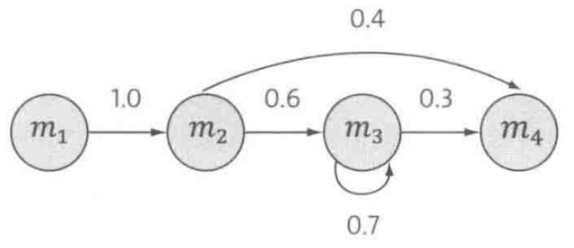
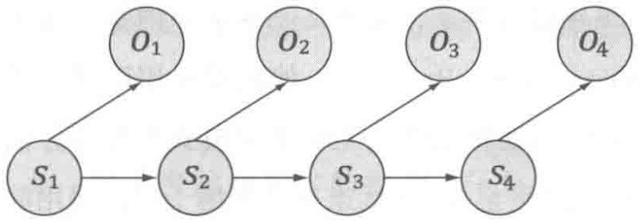
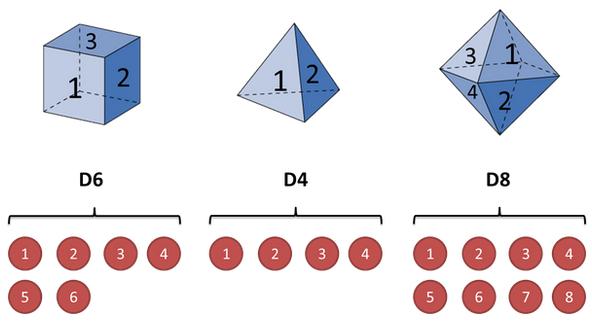
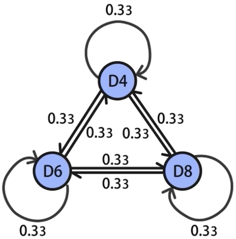
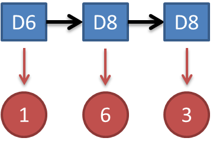
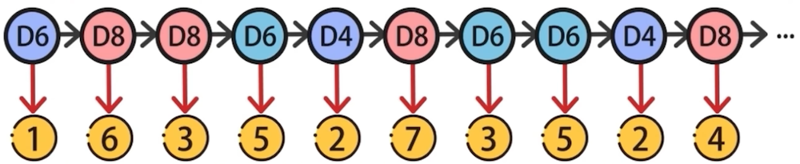
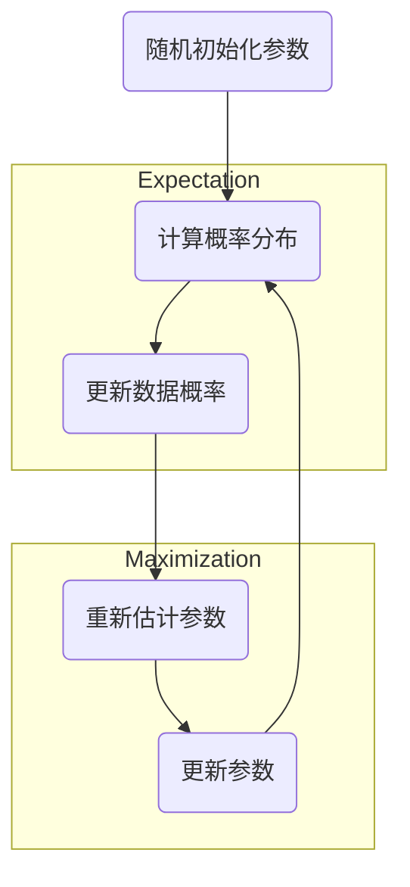

# 隐马尔可夫模型

> [!important]
>
> 马尔科夫假设：系统下一个时刻的状态，仅取决于它当前所处的状态，而与它过去是如何到达这个状态的历史路径完全无关。

符合马尔科夫假设的随机过程称为马尔可夫随机过程，也称马尔科夫链。

* 在⻢尔可夫链的每⼀步，可以从⼀个状态变到另⼀个状态，也可以保持当前状态。
* 状态的改变叫做转移，与不同的状态改变相关的概率叫做转移概率。
* ⻢尔可夫链的数学表示为$P(s_t\mid s_1,s_2,\cdots,s_{t-1})=P(s_t\mid s_{t-1})$。

马尔科夫链运⾏一段时间$T$之后，可以产生⼀个状态序列：$s_1,s_2,\cdots,s_{T}$，根据这个序列统计：

* 状态次数$\#(m_i)$。
* 从状态$m_i$转移到$m_j$的次数$\#(m_i,m_j)$。

状态转移概率为
$$
\frac{\#(m_i,m_j)}{\#(m_i)}
$$
所有的转移概率可以排成一个方阵$P$
$$
P = \begin{bmatrix} 0 & 1.0 & 0 & 0 \\ 0 & 0 & 0.6 & 0.4 \\ 0 & 0 & 0.7 & 0.3 \\ 0 & 0 & 0 & 1.0 \end{bmatrix}
$$
状态转移矩阵的使用：

1. 初始状态向量为：$v^{(0)} = [1, 0, 0, 0]$。
2. 第1步$(t=1)$：$v^{(1)} = v^{(0)} P=[0, 1.0, 0, 0]$。
3. 第2步$(t=2)$：$v^{(2)} = v^{(1)} P = [0, 1.0, 0, 0] P = [0, 0, 0.6, 0.4]$，表示系统有$60\%$的概率处于$m_3$，有$40\%$的概率处于$m_4$。
4. 第3步$(t=3)$：$v^{(3)} = v^{(2)} P = [0, 0, 0.42, 0.58]$，系统有$42\%$的概率处于$m_3$，有$58\%$的概率处于$m_4$。
5. 以此类推……
6. 第20步$(t=20)$：$v^{(20)} = [0, \quad 0, \quad 0.0010, \quad 0.9990]$系统最终的状态将趋向于维持$m_4$。

## 二元语言模型

> [!important]
>
> 统计语言模型的核心思想是：⼀个句⼦是否合理，就看它的可能性⼤⼩如何｡其可能性用概率来衡量。

假定$S$表示⼀个有意义的句⼦，由⼀连串特定顺序排列的词$w_1,w_2,\cdots,w_n$组成，这⾥$n$是句⼦的⻓度｡句子概率表示为
$$
P(S)=P(w_1,w_2,\cdots,w_n)
$$

使用条件概率对上式展开
$$
P(w_1,w_2,\cdots,w_n)=P(w_1)\times P(w_2|w_1)\cdots P(w_n\mid w_1,w_2,\cdots,w_{n-1})
$$
根据马尔科夫假设简化上面的公式
$$
P(w_1,w_2,\cdots,w_n)=P(w_1)\times P(w_2|w_1)\times P(w_3|w_2) \cdots P(w_n\mid w_{n-1}) \tag{1}
$$
对于任意位置$i$的概率
$$
P(w_i\mid w_{i-1})=\frac{P(w_i,w_{i-1})}{P(w_{i-1})} \tag{2}
$$
使用频率来估计概率有
$$
P(w_i,w_{i-1})\approx\frac{\#(w_i,w_{i-1})}{\#} \quad P(w_{i-1})\approx\frac{\#(w_{i-1})}{\#}
$$
根据上面的式子化简公式 $(2)$ 可得
$$
P(w_i\mid w_{i-1})=\frac{\#(w_i,w_{i-1})}{\#(w_{i-1})}
$$
公式 $(1)$ 假设句⼦中的每个词只和前⾯⼀个词有关，称为二元语言模型。

更一般的情况假设，当前次$w_i$的概率取决于前面$N-1$个词，因此
$$
P(w_i\mid w_1, w_2 \cdots w_{i-1}) = P(w_i\mid w_{i-N+1}, w_{i-N+2} \cdots w_{i-1})
$$
的这种假设被称为$N-1$阶⻢尔可夫假设

* 当$N=2$时，称为二元语言模型。
* 当$N=3$时，称为三元语言模型。
* 当$N=1$时，是一个上下文无关的模型。

> [!important]
>
> 一般$N$的取值为2、3、4，更⾼阶的模型一般不会使用。

## 隐马尔科夫模型

隐⻢尔可夫模型是上述⻢尔可夫链的⼀个扩展：任一时刻$t$的状态$s_t$是不可见的，但在每个时刻$t$会输出一个符号$o_t$，而且$o_t$跟$s_t$相关且仅跟$s_t$相关。这个被称为独立输出假设。

隐马尔科夫模型是由美国数学家鲍姆在20世纪六七⼗年代提出的。上面的序列可以表示为
$$
P(s_1,s_2,s_3,\cdots,o_1,o_2,o_3,\cdots)=\prod_{t}P(s_t\mid s_{t-1})\times P(o_t\mid s_t)
$$
围绕着隐⻢尔可夫模型有三个基本问题：

1. 给定⼀ 个模型，如何计算某个特定的输出序列的概率。
2. 给定⼀个模型和某个特定的输出序列，如何找到最可能产⽣这个输出的状态序列。
3. 给定⾜够量的观测数据，如何估计隐⻢尔可夫模型的参数｡

假设有三个不同的骰⼦

挑到每⼀个骰⼦的概率都是三分之一，所以每个骰子的的状态过程如下

状态转移矩阵为
$$
A=\begin{bmatrix}
\frac{1}{3} & \frac{1}{3} & \frac{1}{3} \\
\frac{1}{3} & \frac{1}{3} & \frac{1}{3} \\
\frac{1}{3} & \frac{1}{3} & \frac{1}{3}
\end{bmatrix}
$$

### 评估问题

计算在给定模型下，计算某个特定序列的概率，对应问题一。主要应用是：

* 分类与模型选择。为不同类别分别训练各自的HMM模型。当输入一条新的观测序列时，计算它在各个模型下的概率，概率最高者对应的类别即为预测结果。例如，在手写体数字识别中用于判断输入归属。
* 异常检测。正常行为的观测序列在训练好的模型中通常具有较高的概率；而异常或欺诈行为会导致序列出现的概率极低，从而被精准识别。

三个骰子的观察序列如下

* 隐藏状态序列和观测输出序列都已知
* 计算概率得

$$
\begin{aligned} 
P(O, Q)
&= \underbrace{P(D_6)}_{\text{初始概率}} 
\times \underbrace{P(1 \mid D_6)}_{\text{发射概率1}} \times \underbrace{P(D_8 \mid D_6)}_{\text{转移概率1}} 
\times \underbrace{P(6 \mid D_8)}_{\text{发射概率2}} \times \underbrace{P(D_8 \mid D_8)}_{\text{转移概率2}} 
\times \underbrace{P(3 \mid D_8)}_{\text{发射概率3}}\\
&= \left(\frac{1}{3} \times \frac{1}{6}\right) \times \left(\frac{1}{3} \times \frac{1}{8}\right) \times \left(\frac{1}{3} \times \frac{1}{8}\right) \\
& = \frac{1}{18} \times \frac{1}{24} \times \frac{1}{24} \approx 0.00009645 
\end{aligned}
$$

### 解码问题

给定模型和观测序列，寻找最有可能产生该序列的隐藏状态序列，对应问题二。主要应用是经典的序列标注任务：

* 自然语言处理中的序列标注。例如：中文分词、词性标注、命名实体识别等。
* 语音识别：将底层的音频特征解码转换成对应的音素或文字序列。

三个骰子的观察序列如下

* 只有观测输出序列，隐藏状态序列未知。

一种可能的隐状态如下

> [!tip]
>
> 这种隐状态的概率是最大的么？

隐状态的最优估计应表示为
$$
\begin{aligned} 
s_1,s_2,\cdots s_n
&= \text{argmax}P(s_1,s_2,\cdots s_n\mid o_1,o_2,\cdots o_n)  \\
&= \text{argmax}\prod_{i=1}^{n} P(o_i\mid s_i)\times P(s_i\mid s_{i-1})
\end{aligned}
$$
解决这个问题使用维特比算法

1. 初始化。在第一个时刻$i = 1$，针对每一个状态 $j = 1, 2, \dots, n$，计算其初始概率：

$$
\delta_1(s^{(j)}_1) = P(s^{(j)}_1) \times P(o_1 \mid s^{(j)}_1)
$$

同时初始化回溯指针 $\psi_1(s^{(j)}_1) = 0$。

2. 递推。对于后续时刻 $i>1$，以及当前时刻的每一个目标状态$k = 1, 2, \dots, n$，计算最大概率

$$
\delta_i(s^{(k)}_i) = \max_{j} \left[ \delta_{i-1}(s^{(j)}_{i-1}) \times P(s^{(k)}_i \mid s^{(j)}_{i-1}) \right] \times P(o_i \mid s^{(k)}_i)
$$

记录最优前置状态
$$
\psi_i(s^{(k)}_i) = \arg\max_{j} \left[ \delta_{i-1}(s^{(j)}_{i-1}) \times P(s^{(k)}_i \mid s^{(j)}_{i-1}) \right]
$$

3. 终止。在最后一个时刻$T$，最大概率值

$$
P^* = \max_{j} \delta_T(s^{(j)}_T)
$$

最优终点状态
$$
s^{(j^*)}_T = \arg\max_{j} \delta_T(s^{(j)}_T)
$$

4. 回溯。从最后一个最优状态出发，利用指针$\psi$逆向追踪整条序列，最终得到的序列$s_1, s_2, \dots, s_T$就是全局最优解。

### 模型训练

通过观测数据估计模型参数，包括：转移概率、发射概率，对应问题三。主要用于模型的训练：

* 利用无监督的Baum-Welch算法，让模型自动从海量观测数据中学习规律。

期望最大化算法（Expectation-Maximization Algorithm，简称EM算法），是用于寻找参数最大似然估计的迭代优化策略。

> [!tip]
>
> 现在有1000个成年人的身高数据，用利用这组数据计算人群身高分布的模型？

1000个人的身高分布数据，有男有女，但不知道男女比例。可以假设这个身高分布模型为成分为二的高斯分布。其概率密度函数为
$$
P(x_i) = \pi_1 \mathcal{N}(x_i \mid \mu_1, \sigma_1^2) + \pi_2 \mathcal{N}(x_i \mid \mu_2, \sigma_2^2)
$$

* 成分1代表男性，成分2代表女性。
* 其中$\pi_1 + \pi_2 = 1$表示两个高斯的比例。

1. 初始化。随机给予这 5 个参数一个初始值
   * 初始比例：$\pi_1 = 0.5, \pi_2 = 0.5$
   * 初始均值：$\mu_1 = 1.75, \mu_2 = 1.60$
   * 初始方差：$\sigma_1^2 = 0.05, \sigma_2^2 = 0.04$
2. E步。利用当前参数，计算出每个人属于各个成分的概率权重。对第$i$个人，计算他属于成分男的权重$\gamma_{i,1}$：

$$
\gamma_{i,1} = \frac{\pi_1 \mathcal{N}(x_i \mid \mu_1, \sigma_1^2)}{\pi_1 \mathcal{N}(x_i \mid \mu_1, \sigma_1^2) + \pi_2 \mathcal{N}(x_i \mid \mu_2, \sigma_2^2)}
$$

计算他属于成分 女的权重$\gamma_{i,2}$：
$$
\gamma_{i,2} = 1 - \gamma_{i,1}
$$

3. M步。计算两个成分的有效总人数

$$
N_1 = \sum_{i=1}^{1000} \gamma_{i,1}, \quad N_2 = \sum_{i=1}^{1000} \gamma_{i,2}
$$

更新均值$\mu_1, \mu_2$：
$$
\mu_1 = \frac{\sum_{i=1}^{1000} \gamma_{i,1} x_i}{N_1}, \quad \mu_2 = \frac{\sum_{i=1}^{1000} \gamma_{i,2} x_i}{N_2}
$$
更新方差$\sigma_1^2, \sigma_2^2$：
$$
\sigma_1^2 = \frac{\sum_{i=1}^{1000} \gamma_{i,1} (x_i - \mu_1)^2}{N_1}, \quad \sigma_2^2 = \frac{\sum_{i=1}^{1000} \gamma_{i,2} (x_i - \mu_2)^2}{N_2}
$$
更新混合比例$\pi_1, \pi_2$
$$
\pi_1 = \frac{N_1}{1000}, \quad \pi_2 = \frac{N_2}{1000}
$$

4. 循环迭代与收敛。重复执行E步到M步。直到参数的变化极其微小或迭代足够的次数。

> [!important]
>
> 使用EM算法来解决问题，必须预先假设一个分布模型。

鲍姆-韦尔奇算法（Baum-Welch Algorithm）本质上就是EM算法在隐马尔可夫模型上的实现特例。

1. 初始化。初始概率$P(s^{(j)}_1)$、转移矩阵$P(s^{(k)}_i \mid s^{(j)}_{i-1})$以及发射矩阵$P(o_i \mid s^{(j)}_i)$。
2. E步。根据观察结果，计算每一种可能隐状态的概率。

$$
\gamma_i(s^{(j)}_i) = P(s^{(j)}_i \mid O)
$$

在给定观测序列$O$的情况下，系统在第$i-1$个时刻处于状态$s^{(j)}_{i-1}$、且在第 $i$ 个时刻转移到状态$s^{(k)}_i$的概率
$$
\xi_i(s^{(j)}_{i-1}, s^{(k)}_i) = P(s^{(j)}_{i-1}, s^{(k)}_i \mid O)
$$

3. M步。更新初始状态概率

$$
P(s^{(j)}_1) = \gamma_1(s^{(j)}_1)
$$

更新状态转移概率
$$
P(s^{(k)}_i \mid s^{(j)}_{i-1}) = \frac{\sum_{i=1}^{T-1} \xi_i(s^{(j)}_{i-1}, s^{(k)}_i)}{\sum_{i=1}^{T-1} \gamma_i(s^{(j)}_{i-1})}
$$
更新发射状态概率
$$
P(o \mid s^{(j)}_i) = \frac{\sum_{o_i = o} \gamma_i(s^{(j)}_i)}{\sum_{i=1}^{T} \gamma_i(s^{(j)}_i)}
$$

4. 循环迭代与收敛。
