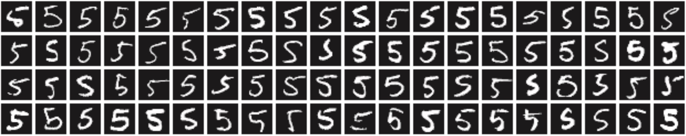
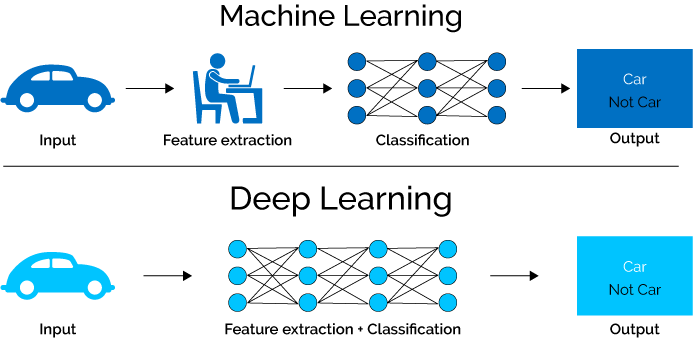
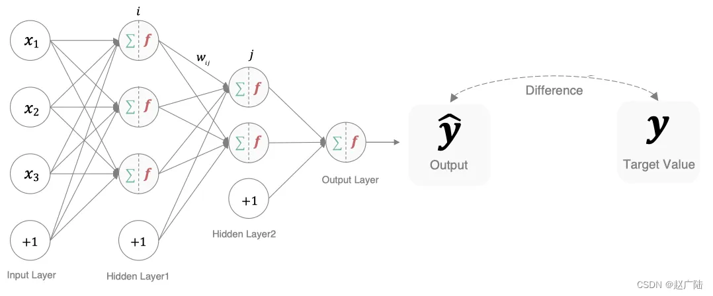
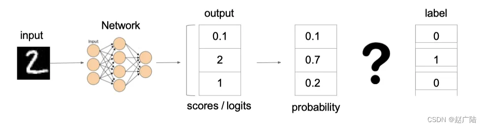
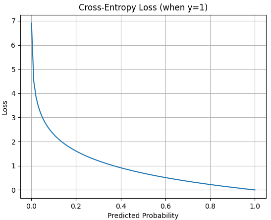
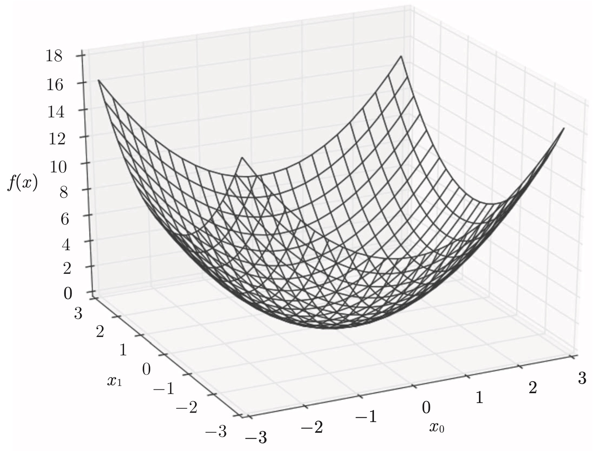
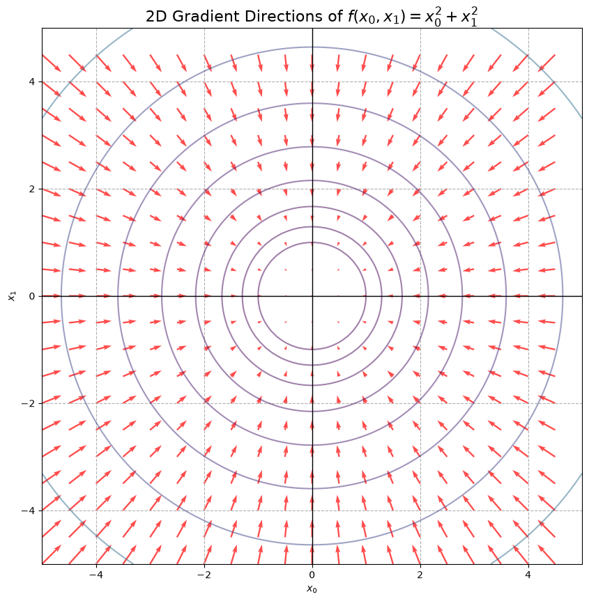
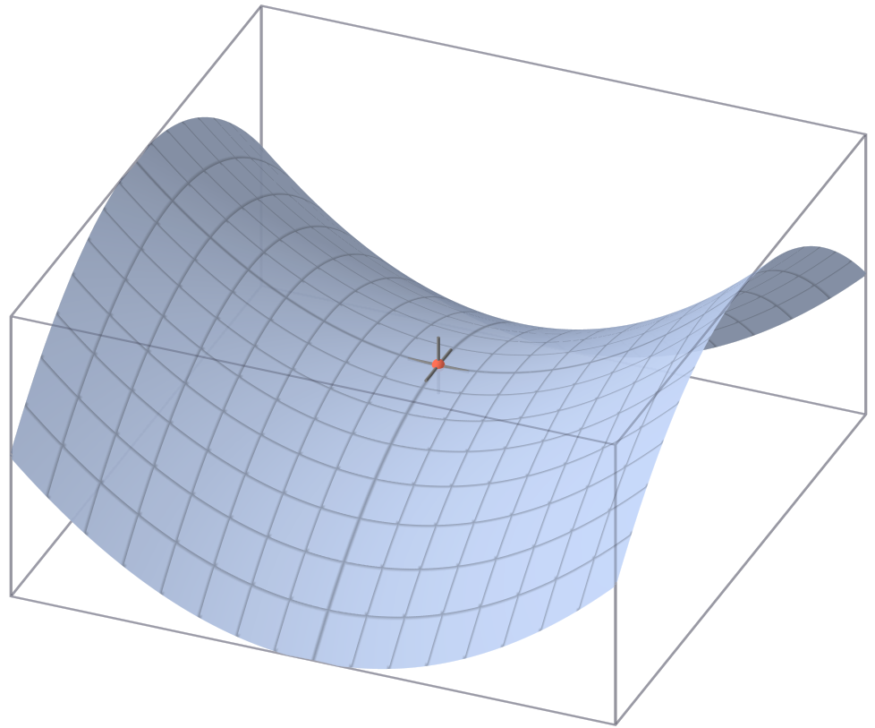
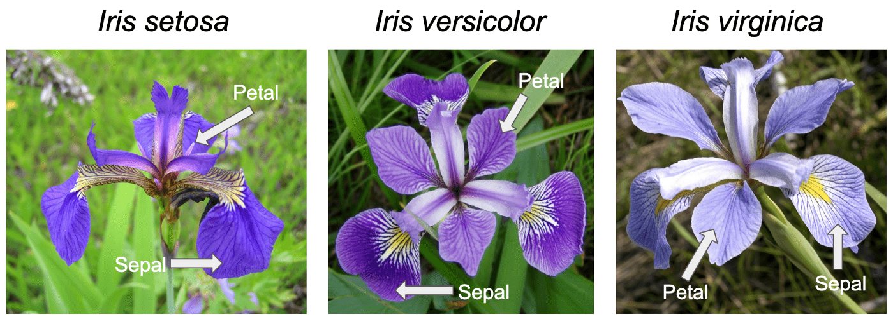
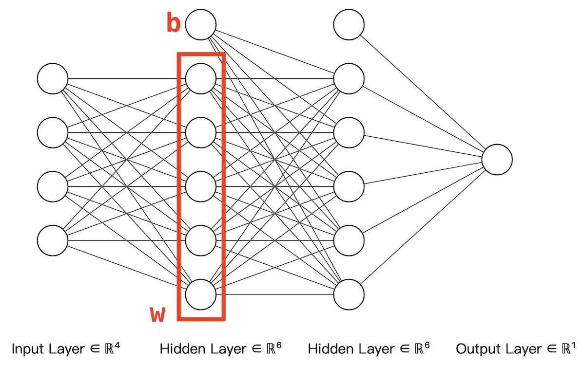

# 神经网络的学习

神经网络的学习，就是从训练数据中获取最优权重参数的过程。

* 神经网络是一种参数学习算法，这些参数是从数据特征中提取出来的。
* 神经网络的学习过程以数据为驱动，则极力避免人为介入。

> [!tip]
>
> 如何实现数字图片中“5”的识别



1. 基本方法：从图像中提取特征量，再用机器学习技术学习这些特征量的模式。

   * 图像中常用的特征，包括：SIFT、SURF 和 HOG等，这种特征可以把图像转换成向量。
   * 常用的机器学习分类器有，SVM、KNN等分类器进行学习。
   * 该方法的存在的问题是，图像转换为特征向量是由人提前设计好的。不同的问题，必须使用合适的特征，才能得到好的结果。
2. 神经网络方法：直接学习图像本身。
   * 特征仍是由人工设计的，但包含在神经网络中。
   * 特征和分类模型都是由机器学习而来。
   * 神经网络的优点是可以将数据作为原始输入，且对所有的问题都可以用同样的流程来解决。

> [!warning]
>
> 深度学习也称为端到端机器学习（end-to-end machine learning ）。端到端的意思，是指从一端到另一端，也就是从原始数据（输入）中获得目标结果（输出）。



在机器学习中特征的提取是由专业人士完成的。在深度学习中，特征的提取集成在网络当中。

## 损失函数

任何机器学习的过程都是最优化目标函数，即最小化损失函数。深度学习中常用的损失函数是：均方误差和交叉熵误差。



### 均方误差

$$
E=\frac{1}{2}\sum_k\left(y_k-t_k\right)^2
$$

* $y_k$表示神经网络的输出。
* $t_k$表示监督数据。
* $k$表示数据的维数。

使用pytroch计算均方误差

```python
import torch
from torch import nn

y1 = torch.tensor([0.1, 0.05, 0.6, 0.0, 0.05, 0.1, 0.0, 0.1, 0.0, 0.0])
y2 = torch.tensor([0.1, 0.05, 0.1, 0.0, 0.05, 0.1, 0.0, 0.6, 0.0, 0.0])
t = torch.tensor([0, 0, 1, 0, 0, 0, 0, 0, 0, 0])

mse = nn.MSELoss()
print(mse(y1, t))
print(mse(y2, t))
```

> [!warning]
>
> 以均方误差为损失函数，当预测值域目标值相差很多时，梯度容易爆炸。梯度爆炸表现在程序上表示计算的结果是数据的溢出。

### 交叉熵损失函数

对于多分类问题交叉熵损失函数表示如下
$$
E=-\sum_kt_k\log y_k
$$

* $\log$表格为以$e$为底数的自然对数。
* $y_k$表示神经网络的输出。
* 交叉熵损失函数中只有标签为1的结果才有输出。



损失函数曲线



* 只有标签为$y_i=1$那一项，进入了最终的求和计算。
* 输入为概率值，范围在$[0, 1]$。
* 函数为递减曲线，当概率为1，损失最小。

> [!warning]
>
> 损失函数形式：二分类是对数损失函数；多分类是交叉熵损失函数。

使用pytroch计算交叉熵损失函数，使用`CrossEntropyLoss`时one-hot编码要转换为标签。

```python
loss = nn.CrossEntropyLoss()
label = torch.argmax(t, dim=0)
print(label)
print(loss(y1, label))
print(loss(y2, label))
```

## 梯度

神经网络的学习采用梯度下降算法，与逻辑回归的梯度下降算法一致。设函数公式如下
$$
f(x_0, x_1)=x_0^2+x_1^2 \tag{1}
$$
该函数的图像如下



### 梯度的计算

对于公式 $(1)$ 梯度可以表示为
$$
\left( \frac{\partial f}{\partial x_0}, \frac{\partial f}{\partial x_1} \right)
$$
根据微分的定义，梯度计算可以使用如下公式
$$
\frac{\partial L}{\partial x_i}\approx\frac{L(x_i+h)-L(x_i-h )}{2h}
$$
梯度的中心差分公式，使用pytorch实现

```python
def numerical_gradient(func, params, epsilon=1e-4):
    grads = []
    for param in params:
        grad = torch.zeros_like(param)
        
        param_flat = param.flatten()
        grad_flat = grad.flatten()

        for i in range(param_flat.numel()):
            original_value = param_flat[i].item()

            # 每个参数的差分计算
            param_flat[i] = original_value + epsilon
            loss1 = func()

            param_flat[i] = original_value - epsilon
            loss2 = func()

            grad_flat[i] = (loss1 - loss2) / (2 * epsilon)
            param_flat[i] = original_value 

        grads.append(grad)
        
    # 返回结果也为一个tensor数组，为梯度的值。
    return grads
```

调用梯度计算函数

```python
# 梯度计算点
x = torch.tensor([3.0, 4.0], requires_grad=False)

# lambda: x[0]**2 + x[1]**2 目标函数
grads = numerical_gradient(lambda: x[0]**2 + x[1]**2, [x])
print("x:", x)
print("Numerical gradient:", grads[0])
```

> [!important]
>
> 梯度下降的方向是各点处的函数值减小最多的方向。

绘制公式 $(1)$ 的梯度下降方向为



公式 $(1)$ 的梯度下降法数学表达式为
$$
x_0 = x_0-\eta\frac{\partial f}{\partial x_0} \qquad 
x_1 = x_1-\eta\frac{\partial f}{\partial x_1}
$$

* $\eta$表示学习率。

### mini-batch学习

梯度下降算法是寻找梯度为0的点，但当失函数很复杂，参数空间庞大时，函数的极小值、最小值以及鞍点 （saddle point） 的梯度均为0。

* 极小值是局部最小值，也就是限定在某个范围内的最小值。
* 鞍点是从某个方向上看是极大值，从另一个方向上看则是极小值的点。



跳出鞍点和局部最优的方法

1. 机器学习过程中上述问题，可以通过反复学习和随机初始化等方法解决。
2. 使用随机梯度下降方法，更容易跳出鞍点和局部最优点。

> [!important]
>
> 工程实践中一般使用mini-batch方法代替随机梯度下降。

### 学习算法的实现

神经网络的学习步骤：

1. 从训练数据中随机选出一部分数据，这部分数据称为mini-batch。
2. 使用前向传播算法和损失函数，共同得到神经网络函数。
3. 根据神经网络函数，要求出各个权重参数的梯度。
4. 将权重参数，沿梯度下降的方向进行微小更新。
5. 重复上述过程，迭代终止条件：
   * 迭代指定多的次数
   * 权重参数减小数量级，小于一定阈值。

使用iris数据集来验证网络算法，选择其中两种类别



```python
from sklearn.datasets import load_iris
from sklearn.model_selection import train_test_split
import numpy as np

iris = load_iris()
X = iris.data
y = iris.target

# 选择两类数据
indices_0_1 = np.where((y == 0) | (y == 1))[0]
data = X[indices_0_1]
label = y[indices_0_1]

# 划分训练集和测试集
X_train, X_test, y_train, y_test = train_test_split(data, label, test_size=0.2, random_state=0)

# 数据类型转换为pytorch
X_train = torch.from_numpy(X_train).float()
y_train = torch.from_numpy(y_train).long()
X_test = torch.from_numpy(X_test).float()
y_test = torch.from_numpy(y_test).long()
```

 定义一个3层的神经网络，网络结构如下



定义神经网络参数

```python
torch.manual_seed(42)

def init_params():
    W1 = torch.randn(5, 4, dtype=torch.float32, requires_grad=False) * 0.1
    b1 = torch.randn(5, dtype=torch.float32, requires_grad=False) * 0.1
    W2 = torch.randn(5, 5, dtype=torch.float32, requires_grad=False) * 0.1
    b2 = torch.randn(5, dtype=torch.float32, requires_grad=False) * 0.1
    W3 = torch.randn(1, 5, dtype=torch.float32, requires_grad=False) * 0.1
    b3 = torch.randn(1, dtype=torch.float32, requires_grad=False) * 0.1
    return [W1, b1, W2, b2, W3, b3]
```

前向传播计算

```python
def forward(x, params):
    W1, b1, W2, b2, W3, b3 = params
    z1 = W1 @ x + b1           
    a1 = torch.sigmoid(z1)     
    z2 = W2 @ a1 + b2          
    a2 = torch.sigmoid(z2)     
    z3 = W3 @ a2 + b3          
    y_pred = torch.sigmoid(z3)
    return y_pred.squeeze()
```

更新网络参数

```python
def update_params(params, grads, lr=0.1):
    for p, g in zip(params, grads):
        p -= lr * g
```

训练函数如下

```python
import torch.nn.functional as F

def train(x_all, y_all, epochs=100, lr=0.1, loss_values=None):
    params = init_params()
    N = x_all.shape[0]
    for epoch in range(epochs):
        total_loss = 0.0
        
        # 遍历所有数据
        for i in range(N):
            
            # 每次只取一条样本用于梯度计算，随机梯度下降
            x = x_all[i]
            y_true = y_all[i]
            
            # 前向函数和损失函数共同构成网络函数
            # forward(x, params)计算中W1@x维度为(5,4)@(4,)→(5,)，每次只计算一条样本。
            loss_fn = lambda: F.binary_cross_entropy(forward(x, params), y_true)
            
            # 记录每次损失
            loss = loss_fn()
            total_loss += loss.item()

            # 使用差分法计算参数梯度值
            grads = numerical_gradient(loss_fn, params)
            
            # 使用梯度更新参数
            update_params(params, grads, lr)

        # 记录损失函数平均值
        avg_loss = total_loss / N
        loss_values.append(avg_loss)
        print(f"Epoch {epoch}, Avg Loss: {avg_loss:.6f}")
    return params
```

* 训练轮数（epoch）是一个单位，一个epoch表示学习中所有训练数据均被使用过一次时的更新次数。
* 每经过一个epoch，会记录损失函数。

调用训练函数

```python
%%time
loss_values = []
params = train(X_train, y_train, epochs=20, lr=0.5, loss_values=loss_values)
```

绘制损失函数曲线

```python
plt.figure(figsize=(10, 5))
plt.plot(loss_values, linewidth=3)
plt.grid(True, linestyle='--')
plt.xticks(fontsize=16)
plt.yticks(fontsize=16)
plt.show() 
```

从图中可以发现，损失函数的值在不断减小，表示学习正常进行，即神经网络的权重在逐渐拟合数据。通过反复地向它浇灌数据，神经网络正在逐渐向最优参数靠近。

### 训练周期参数

| 名称      | 定义                                                         |
| --------- | ------------------------------------------------------------ |
| epoch     | 使用训练集的全部数据，对模型进行一次完成的训练，称为一轮训练。 |
| batch     | 使用训练集的一小部分数据，对模型参数进行一次更新，这小部分数据称为一批数据。 |
| iteration | 使用一个batch数据，对模型参数进行一次更新的过程，称为一次训练 |

对于10000条训练数据，用大小为100条数据的mini-batch进行学习

* 重复随机梯度下降法100次，所有的训练数据就都被使用过了。
* 100次就是一个epoch（一轮训练）。
* 如果训练10个epoch，就是进行1000训练（iteration）。

### 模型评价

神经网络学习的目标是掌握泛化能力，虽然损失函数值减小，表示神经网络的学习正常进行，但由于过拟合现象的存在，不能保证学习的目标是正确的。要评价神经网络的泛化能力，就必须使用测试数据进行预测。

```python
def evaluate(params, x_test, y_test):
    correct = 0
    total = len(y_test)
    for i in range(total):
        x = x_test[i]
        y_true = y_test[i]

        y_pred = forward(x, params)
        predicted_class = y_pred > 0.5

        if predicted_class == y_true.item():
            correct += 1
    acc = correct / total
    print(f"Test Accuracy: {acc * 100:.2f}%")
    
evaluate(params, X_test, y_test)
```

学习过程分析：

1. 在学习过程中首先应该观察loss曲线
   * loss曲线呈现下降趋势，说明训练过程是正确的。
   * loss曲线是震荡的而不下降，说明学习过程是错误，要从数据、模型和代码实现上分析问题。
2. 在loss曲线呈现下降趋势的条件下，观察训练和测试的准确度：
   * 如果训练数据的准确度高，测试数据的准确度低，则为过拟合。
   * 如果练数据的准确度和测试数据的准确度都低，可能是模型不适合。

通过数值微分，计算神经网络权重参数的梯度，这种方法存在的问题

* 计算效率低。
* 数值不稳定性，数值微分对$h$的选择非常敏感。
* 无法处理高维数据。
* 不适合大规模数据集。
