# 反向传播法算法

20世纪80年代末期，反向传播算法（Back Propagation，简称BP算法）被引入神经网络训练中。

## 计算图

计算图通过节点和箭头表示计算过程，包括：节点和相互连接的边。

> [!tip]
>
> 例1：小明在超市买了2个100元一个的苹果，消费税是10%，请计算支付金额。

使用计算图表示上述问题

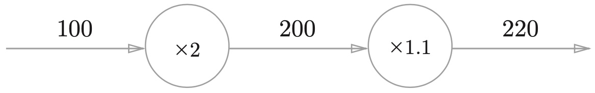

如果将运算表示为节点，数值作为边，上述计算图表示为

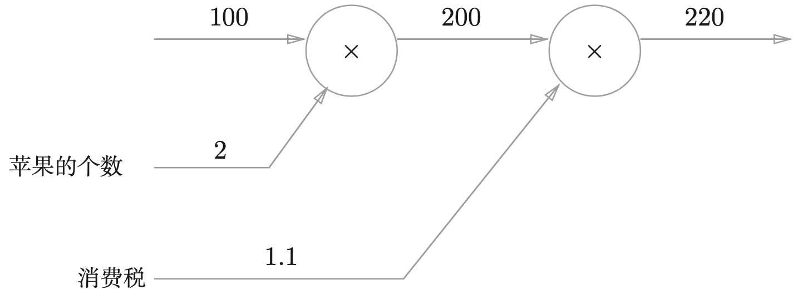

计算过程从左向右进行，最终得到计算结果，这一过程简称为正向传播 （forward propagation）。

> [!tip]
>
> 例2：小明在超市买了2个苹果、3个橘子。其中，苹果每个100元，橘子每个150元。消费税是10%，请计算支付金额。

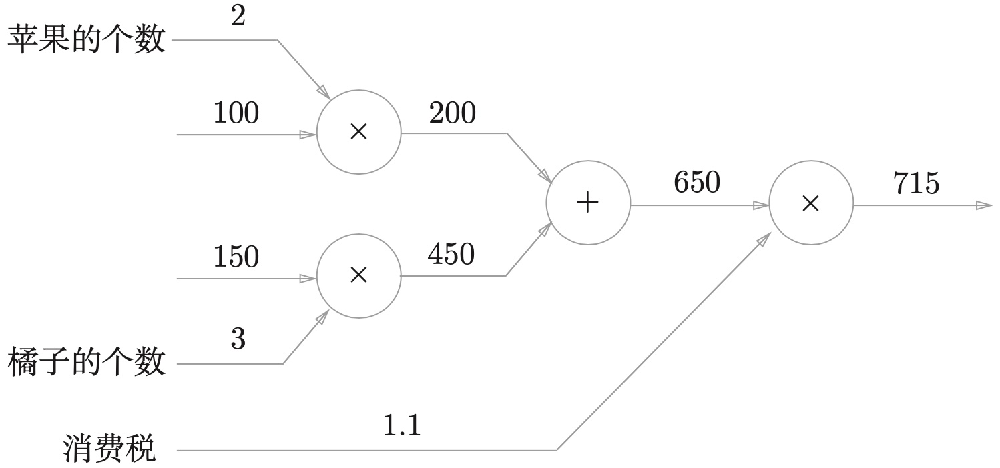

* 上述计算图中增加了加法节点`+`，用来合计苹果和橘子的金额。

计算图的特征是可以通过传递“局部计算”获得最终结果。

> [!important]
>
> 局部计算是指，无论前面的计算过程如何复杂，都只根据与自己相关的输入来计算输出结果。


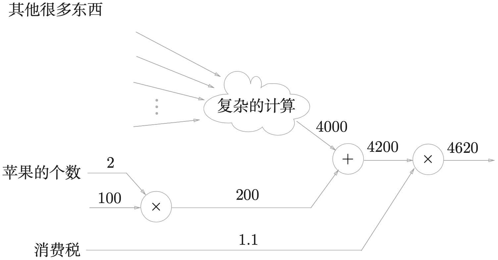

计算图可以通过反向传播高效计算导数。与正向计算相反的计算，称为反向传播，在上述例子中是从右向左计算。

> [!tip]
>
> 例3：在例1中，计算支付金额关于苹果的价格的导数。

设苹果的价格为$x$，支付金额为$L$，则相当于求$\frac{\partial L}{\partial x}$。这个导数的值表示当苹果的价格稍微上涨时，支付金额会增加多少。

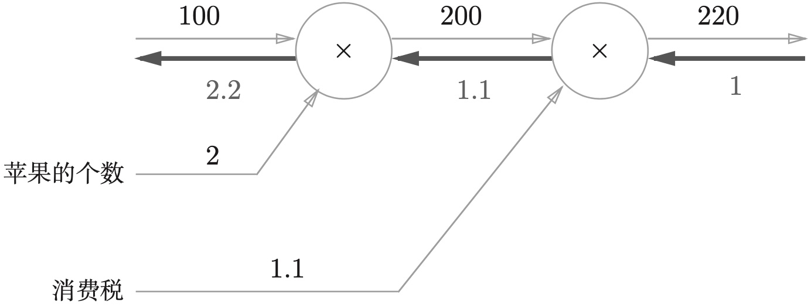

* 粗线表示反向传播的计算过程。
* 初始值为$1$代表了最终输出对自身的求导。

$$
\begin{aligned} 

\text{初始值} & \rightarrow 1 \\
\text{第一次传播} & \rightarrow \frac{220}{200}\times1=1.1 \\
\text{第二次传播} & \rightarrow \frac{200}{100}\times1.1=2.2 \\
\end{aligned}
$$

反向传播的结果表示，苹果的价格上涨1元，最终的支付金额会增加2.2元
$$
\begin{aligned} 

& 100\times2\rightarrow200\times1.1\rightarrow220 \\
& 101\times2\rightarrow202\times1.1\rightarrow222.2 \\
& 222.2-220=2.2 \\
\end{aligned}
$$

* 苹果的价格增加某个微小值，则最终的支付金额将增加那个微小值的2.2倍。
* 同理可求
  * 关于消费税的导数
  * 关于苹果的个数的导数

### 链式法则

链式法则：如果某个函数由复合函数表示，则该复合函数的导数，可以用构成复合函数的各个函数的导数的乘积表示。假设存在函数$y=f(x)$，链式法则可以表示为如下计算图

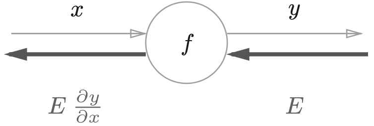

反向传播求导的计算顺序是，将信号$E$乘以节点的局部导数$\frac{\partial y}{\partial x}$，然后将结果传递给下一个节点。例如
$$
y=f(x)=x^2 \Rightarrow \frac{\partial y}{\partial x}=2x \Rightarrow 2xE
$$

> [!warning]
>
> 复合函数的求导问题，可以用计算图的形式表示。反向传播求导的原理可以通过链式法则进行证明。

### 常用函数导数

| 函数                                     | 导数                     |
| ---------------------------------------- | ------------------------ |
| $f(a)=a^2$                               | $2a$                     |
| $f(a)=a^3$                               | $3a^2$                   |
| $f(a)=\ln(a)$                            | $\frac{1}{a}$            |
| $f(a)=e^a$                               | $e^a$                    |
| $\sigma(z)=\frac{1}{1+e^{-z}}$           | $\sigma(z)(1-\sigma(z))$ |
| $\tanh(z)=\frac{e^z-e^{-z}}{e^z+e^{-z}}$ | $1-\tanh(z)^2$           |

## 反向传播

### 加法的反向传播

函数$z=y+x$，其偏导数计算如下
$$
\frac{\partial z}{\partial x}=1 \qquad \frac{\partial z}{\partial y}=1
$$
其计算图为

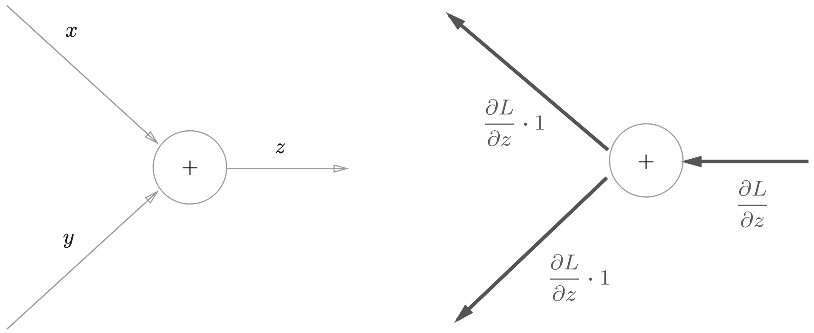

其中$\frac{\partial L}{\partial z}$表示上游的计算结果。假设有计算$10+5=15$，反向传播上游计算的结果为$1.3$，则有

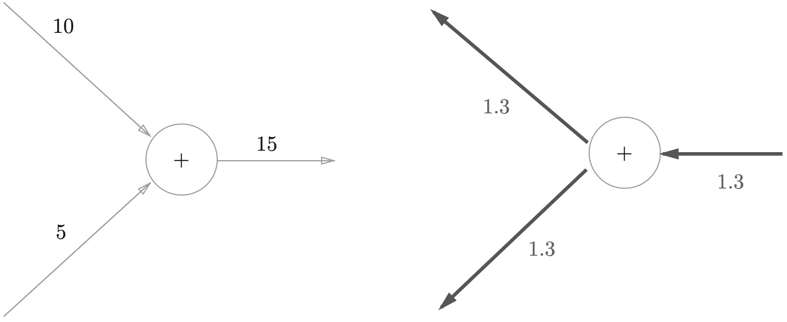

### 乘法的反向传播

函数$z=xy$，其偏导数计算如下
$$
\frac{\partial z}{\partial x}=y \qquad \frac{\partial z}{\partial y}=x
$$
其计算图为

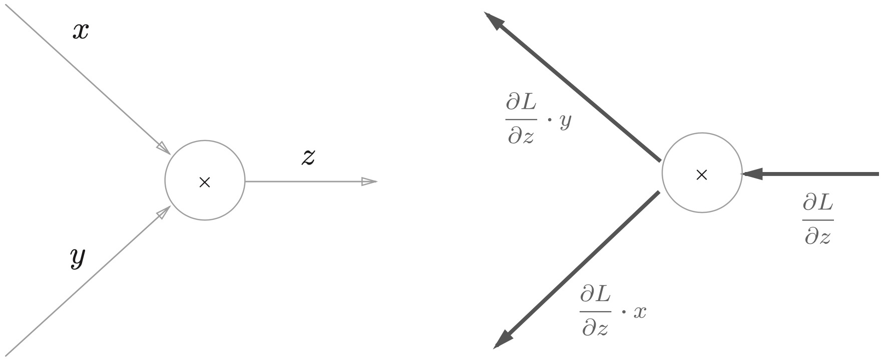

假设有计算$10\times5=50$，反向传播上游计算的结果为$1.3$，则有

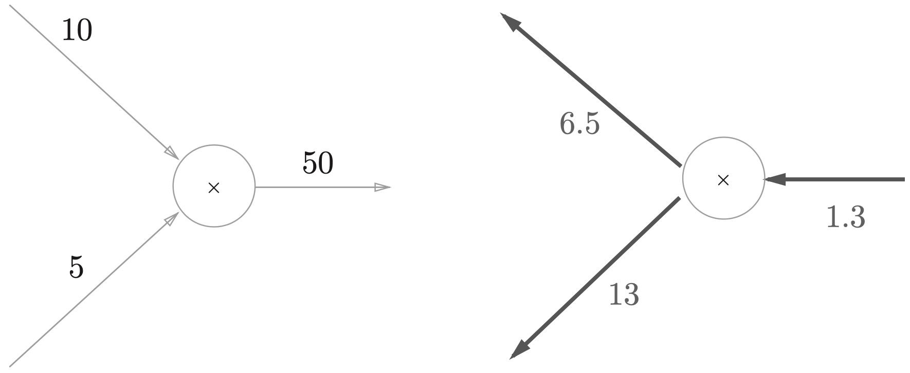

### 反向传播的实例

考虑例1中全部输入的反向传播

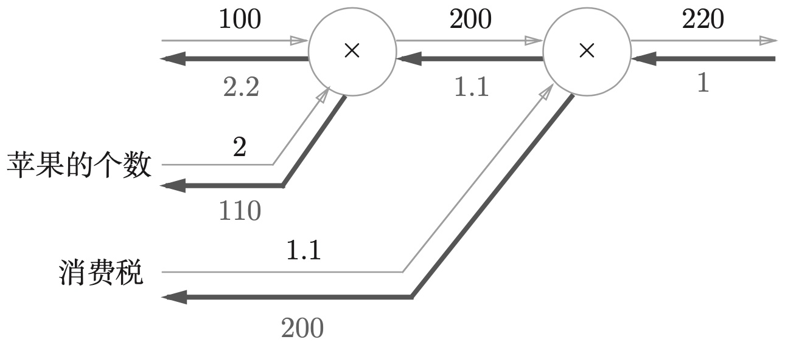

1. 苹果价格的导数是2.2。
2. 苹果个数的导数是110。
3. 消费税的导数是200。

可以理解为，如果消费税和苹果的价格增加值相同

1. 消费税将对最终价格产生200倍大小的影响
2. 苹果价格对最终价格产生2.2倍大小的影响。

形成这样结果的原因是，中消费税和苹果的价格的**量纲不同**。

[反向传播算法的数学证明](https://zh.d2l.ai/chapter_multilayer-perceptrons/backprop.html#id4)

## 网络层实现

> [!important]
>
> 反向传播算法的核心思想：损失函数对每个一参数的导数，可以由上一层的反向输入计算。

使用反向传播算法，同样可以计算每个参数的梯度

1. 最后一层是损失函数输出，保留原值。
2. 根据根据偏导数和计算法则，可以求出前一层的梯度。
3. 以此类推，完成整个网络的梯度计算。

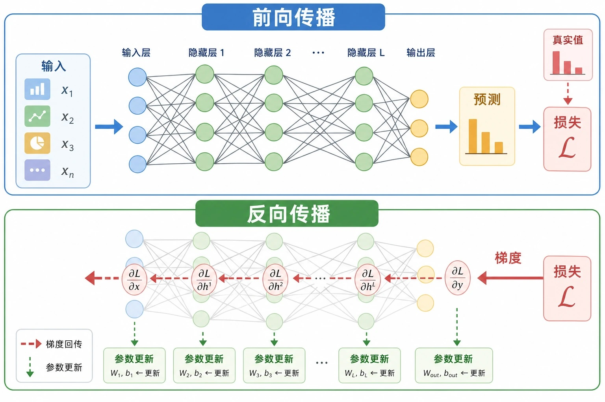

### 简单层的实现

> [!tip]
>
> 使用反向传播算法来重新实现，上一章3层的神经网络。数据导入可以复用上一章代码

通常把构建神经网络的“层”，设计为一个类。“层”表示为神经网络中功能的单位。比如：sigmoid函数计算、矩阵的乘积等，都以层为单位进行实现。

Sigmoid函数公式和导数公式如下，根据符合函数求导法则可以计得出，该导数可以由函数本身表示
$$
\sigma(t)=\frac{1}{1+e^{-t}} \Rightarrow 
{\sigma(t)}' =\sigma(t)\cdot(1-\sigma(t))
$$

Sigmoid函数的代码实现

```python
class Sigmoid:
    def __init__(self):
        self.out = None

    def run(self, x):
        self.out = torch.sigmoid(x)
        return self.out

    def back(self, dout):
        if self.out is None:
            raise RuntimeError("Must call forward before backward")
        dx = dout * (1.0 - self.out) * self.out
        return dx
```

其中`torch.sigmoid`是Pytorch封装的函数，与`nn.Sigmoid`一样。正向传播的结果保存在属性`out`中。

### 全连接层的实现

全连接层是指，相邻层的所有神经元之间都有连接，通常用Affine表示。其计算公式为
$$
Y=WX+B
$$
其中$Y$、$X$和$B$都表示矩阵。假设有全连接层计算图为

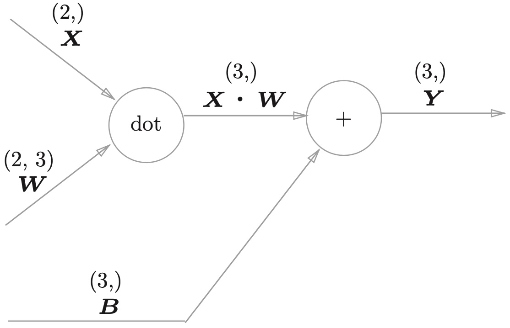

全连接层的反向传播计算公式

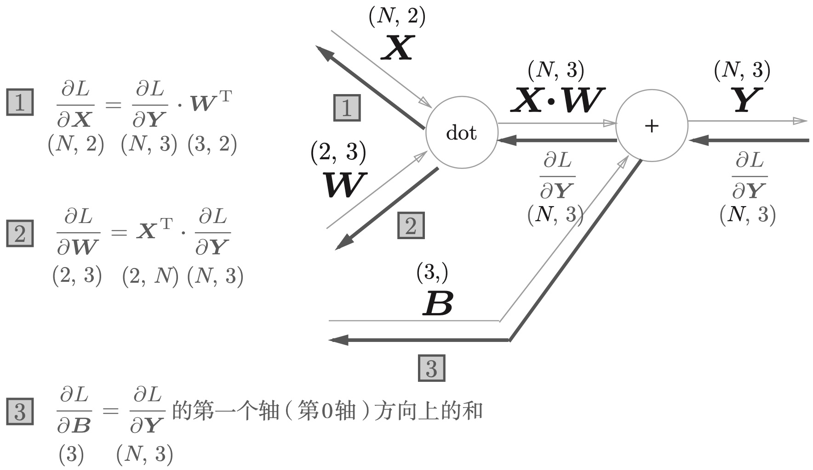

1. 公式（1）对梯度跟新无无用。
2. 公式（2）可以计算$W$的梯度，基于矩阵微积分的基本规则。
3. 公式（3）可以计算$B$的梯度，基于广播机制与分批求导得出。

全连接层的代码实现

```python
class Affine:
    def __init__(self, W, b):
        self.W = W
        self.b = b
        self.x = None
        self.dW = None
        self.db = None

    def run(self, x):
        self.x = x
        out = torch.matmul(x, self.W) + self.b
        return out

    def back(self, dout):
        dx = torch.matmul(dout, self.W.T)
        self.dW = torch.matmul(self.x.T, dout)
        self.db = torch.sum(dout, dim=0)
        return dx
```

假设全连接层的参数如下

$$
W=
\begin{pmatrix}
 w_{11} & w_{21} & w_{31}\\
 w_{12} & w_{22} & w_{32}
\end{pmatrix}
$$
参数的梯度计算如下
$$
\frac{\partial L}{\partial W} =
\begin{pmatrix}
\frac{\partial L}{\partial w_{11}}  & \frac{\partial L}{\partial w_{12}} & \frac{\partial L}{\partial w_{13}} \\
\frac{\partial L}{\partial w_{21}}  & \frac{\partial L}{\partial w_{22}} & \frac{\partial L}{\partial w_{23}}
\end{pmatrix}
$$
全连接层的参数优化就是$W$中的每个值，减去梯度和学习率的乘积。

### SigmoidWithLoss层实现

这里要进行2分类，Sigmoid层输出分类概率，使用对数损失函数计算Loss，作为网络最后一层。

反向传播算法的优化目标

1. 得到了输出结果和监督数据的差异。
2. 反向传播会把这个差异表示的误差，作为反向传播的输入，传递给前面的层。
3. 神经网络学习目的就是通过调整权重参数，使神经网络的输出接近监督数据。

SoftmaxWithLoss的代码实现

```python
import torch.nn.functional as F

class SigmoidWithLoss:
    def __init__(self):
        self.loss = None
        self.y = None
        self.t = None

    def run(self, x, t):
        self.t = t
        self.y = torch.sigmoid(x)
        # 对数损失函数
        self.loss = F.binary_cross_entropy(self.y, self.t)
        return self.loss

    def back(self, dout=1):
        batch_size = self.t.shape[0]
        dx = (self.y - self.t) / batch_size
        return dx.unsqueeze(1)
```

## 反向传播算法的实现

> [!important]
>
> 反向传播算法本质：可以快速计算出参数的梯度，从而进行参数更新。

神经网络的学习步骤：

1. 从训练数据中随机选择一部分数据。
2. 通过前向计算，计算出网络的输出。
3. 根据输出结果和监督数据，计算损失函数。
4. 根据损失函数，反向计算各个权重的梯度。
5. 将权重参数沿梯度方向进行微小的更新。
6. 重复步骤 1、 2、3、4、5。

```python
from collections import OrderedDict

class IrisNet:
    def __init__(self):
        self.params = {}
        # 调整权重形状：W1 (4,5), W2 (5,5), W3 (5,1)
        self.params['W1'] = torch.randn(4, 5, dtype=torch.float32, requires_grad=False) * 0.1
        self.params['b1'] = torch.randn(5, dtype=torch.float32, requires_grad=False) * 0.1
        self.params['W2'] = torch.randn(5, 5, dtype=torch.float32, requires_grad=False) * 0.1
        self.params['b2'] = torch.randn(5, dtype=torch.float32, requires_grad=False) * 0.1
        self.params['W3'] = torch.randn(5, 1, dtype=torch.float32, requires_grad=False) * 0.1
        self.params['b3'] = torch.randn(1, dtype=torch.float32, requires_grad=False) * 0.1

        self.layers = OrderedDict()
        self.layers['Affine1'] = Affine(self.params['W1'], self.params['b1'])
        self.layers['Sigmoid1'] = Sigmoid()
        self.layers['Affine2'] = Affine(self.params['W2'], self.params['b2'])
        self.layers['Sigmoid2'] = Sigmoid()
        self.layers['Affine3'] = Affine(self.params['W3'], self.params['b3'])
        self.lastLayer = SigmoidWithLoss()

    def predict(self, x):
        for layer in self.layers.values():
            x = layer.run(x)
        return x.squeeze()  # 去掉多余的维度，输出形状为 (batch_size,)

    def loss(self, x, t):
        y = self.predict(x)
        return self.lastLayer.run(y, t)

    def gradient(self, x, t):
        self.loss(x, t)
        dout = 1
        dout = self.lastLayer.back(dout)
        layers = list(self.layers.values())[::-1]  # 反向传播需要逆序
        for layer in layers:
            dout = layer.back(dout)

        grads = {}
        grads['W1'] = self.layers['Affine1'].dW
        grads['b1'] = self.layers['Affine1'].db
        grads['W2'] = self.layers['Affine2'].dW
        grads['b2'] = self.layers['Affine2'].db
        grads['W3'] = self.layers['Affine3'].dW
        grads['b3'] = self.layers['Affine3'].db
        return grads

    def accuracy(self, x, t):
        y = self.predict(x) > 0.5
        accuracy = torch.sum(y == t).item() / float(x.shape[0])
        return accuracy
```

使用反向传播算法训练模型

```python
%%time
network = IrisNet()

iters_num = 400
learning_rate = 0.5
train_loss_list = []
train_acc_list = []
test_acc_list = []

for i in range(iters_num):
    grad = network.gradient(X_train, y_train)

    for key in ('W1', 'b1', 'W2', 'b2', 'W3', 'b3'):
        network.params[key] -= learning_rate * grad[key]

    loss = network.loss(X_train, y_train)
    train_loss_list.append(loss.item())

    train_acc = network.accuracy(X_train, y_train)
    test_acc = network.accuracy(X_test, y_test)
    train_acc_list.append(train_acc)
    test_acc_list.append(test_acc)
    if i % 50 == 0:
        print(f"Epoch {i}, loss: {loss:.4f}, "
              f"Train Acc: {train_acc:.4f}, Test Acc: {test_acc:.4f}")
```

可以根据上面训练过程的损失函数和准确率，绘制相关学习曲线。

## Pytorch自动求导

在整个PyTorch框架中，所有的神经网络，本质上都是一个自动求导工具包（autograd package），它提供了一个对Tensors上，所有的操作自动微分的功能。

### 关于`torch.tensor`

`torch.tensor`是整个package中的核心类，以购买苹果的例子验证自动求导

```python
x1 = torch.tensor(100, dtype=torch.float32)
print(x1)

# 将属性requires_grad设置为True，启用自动求导功能
x = torch.tensor(100.0, requires_grad=True)
print(x)
```

> [!warning]
>
> 只有浮点类型和复数类型的张量，才能设置启用自动求导功能

对`tensor`执行称法操作

```python
y = x * 2
print(y)
```

### 关于`torch.autograd.Function`

PyTorch 的核心类，每一个操都会被记录为一个`Function`对象，当代码进行反向传播时，直接调用`backward()`，系统通过反向遍历这些`Function`对象来计算梯度的。

每一个`tensor`拥有一个`grad_fn`属性，属性引用的是一个`Function`对象，记录了这个张量是由哪个数学操作创建出来的。

```python
# 用户自定义的tensor其grad_fn属性是None
print(x.grad_fn)

# 根据乘法计算得到
print(y.grad_fn)
```

在`tensor`上继续执行前向计算

```python
z = y * 1.1
print(z)
```

### 自动求导属性

当代码进行反向传播时，直接调用`backward()`，可以自动计算梯度。

```python
z.backward()

# tensor上的所有梯度，被累加进属性grad中。
print(x.grad)
```

`tensor.requires_grad`属性标识该张量是否被自动求导机制追踪，默认值为`False`。

```python
x1 = torch.tensor(100, dtype=torch.float32)
out = x1 * 2 * 1.1
print(x1.requires_grad)
print(out.grad_fn)
```

`requires_grad_()`方法，可以原地修改张量梯度追踪状态。

```python
x1.requires_grad_(True)
out1 = x1 * 2 * 1.1
print(x1.requires_grad)
print(out1.grad_fn)
```

如果想终止对整个计算图的回溯，也就是不再进行反向传播， 可以采用代码块的方式`with torch.no_grad():`，一般适用于模型推理阶段。

* `with torch.no_grad():`不会改变已标注的计算图

```python
with torch.no_grad():
    print(x1.requires_grad)
```

* 新运算不在建计算图

```python
print((x1 * 2 * 1.1).requires_grad)

with torch.no_grad():
    print((x1 * 2 * 1.1).requires_grad)
```

如果终止一个`tensor`在计算图中的回溯，只需要执行`detach()`，就可以将该`tensor`从计算图中撤下。

```python
print(x1.requires_grad)

# x和y数值完全相同，共享底层数据，唯一的差别是requires_grad
y = x1.detach()
print(x1.requires_grad)

# 比例两个元素是否相等，
print(x1.eq(y).all())
```

在PyTorch中执行反向传播，调用`loss.backward()`：

1. 整张计算图将对损失函数进行自动求导；
2. 有属性`requires_grad=True`的Tensor将参计算梯度；
3. 梯度计算的结果，累加到这些Tensors的`grad`属性中；

```python
from torch import nn

y = torch.tensor([0.1, 0.05, 0.6, 0.0, 0.05, 0.1, 0.0, 0.1, 0.0, 0.0], requires_grad=True)
criterion = nn.CrossEntropyLoss()
loss = criterion(y, torch.tensor(2))
print(loss)
loss.backward()
print(y.grad)
```

## 网络构建

构建神经网络的一般流程

1. 定义一个拥有可学习参数的神经网络。
2. 遍历训练数据集。
3. 输入数据计算前向传播结果。
4. 根据计算结果和监督数据，计算损失值。
5. 根据损失值，计算梯度进行反向传播。
6. 以一定的规则，更新网络的权重。
7. 重复上述过程，迭代一定的次所，或者损失函数不在减少时停止。

构建完整的鸢尾花的分类网络

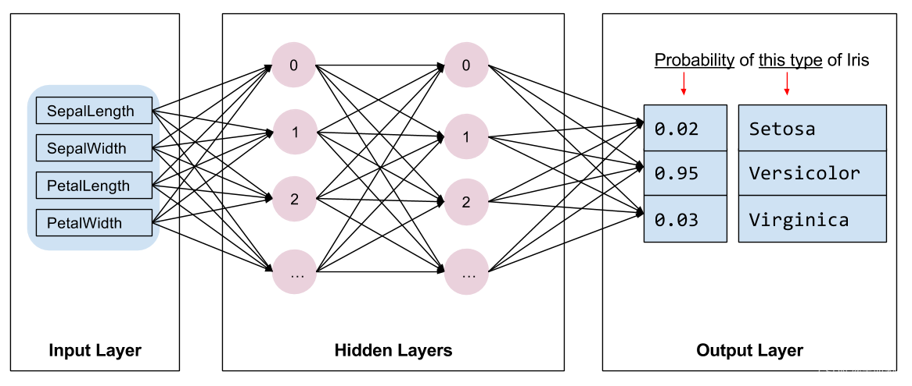

其中两隐层为10个神经元。

### 全连接

Pytorch中全连接层实现为

```python
# in_features是输入数据维度；out_features是输出数据维度
nn.Linear(in_features, out_features)
nn.Linear(4, 10)
```

### `Sequential`

PyTorch构建网络的常用方式有两种。`Sequential`是按顺序创建堆叠模型

```python
model = nn.Sequential(
    nn.Linear(4, 10),    
    nn.ReLU(),           
    nn.Linear(10, 10),   
    nn.ReLU(),
    nn.Linear(10, 3),  
)
```

> [!warning]
>
> 创建模型时，不需要手动添加`softmax`层，PyTorch的`CrossEntropyLoss`已内置`softmax`，可以避免数值不稳定性问题。

安装`torchinfo`包可以打印网络信息，安装命令

```shell
pip install torchinfo
```

打印网络信息

```python
from torchinfo import summary
summary(model, input_size=(1, 4))
```

> [!important]
>
> 在构建网络的同时，框架会自动对权重进行初始化，并开启自动求导属性。

### 模型训练

1. 准备数据，将数据转换为张量形式。数据输入的格式为

```
[batch, ndim] * [in_features, out_features] ==> [112, 4] * [4, 10]
```

2. 创建损失函数和优化器

```python
criterion = nn.CrossEntropyLoss()
optimizer = torch.optim.SGD(model.parameters(), lr=0.5)
```

3. 训练模型，PyTorch需要手动编写训练循环。

```python
num_epochs = 10000

# 设置为训练模式
model.train()
for epoch in range(num_epochs):
    # 前向传播
    outputs = model(x_train_tensor)
    loss = criterion(outputs, y_train_tensor)
    
    optimizer.zero_grad()
    loss.backward()
    optimizer.step()
    _, train_predicted = torch.max(outputs.data, 1)
    train_accuracy = (train_predicted == y_train_tensor).sum().item() / y_train_tensor.size(0)
    if (epoch + 1) % 100 == 0:
        print(f'Epoch [{epoch+1}/{num_epochs}], Loss: {loss.item():.4f},  训练集准确率: {train_accuracy:.4f}')
```

> [!important]
>
> PyTorch的设计哲学更倾向于灵活性和显式控制训练过程，所以需要手动编写训练循环。

4. 评价模型性能。

```python
# 设置为验证模式
model.eval()

# 不需要反向传播运算
with torch.no_grad():
    outputs = model(x_test_tensor)
    _, predicted = torch.max(outputs.data, 1)
    accuracy = (predicted == y_test_tensor).sum().item() / y_test_tensor.size(0)
    print(f'测试集准确率: {accuracy:.4f}')
```

