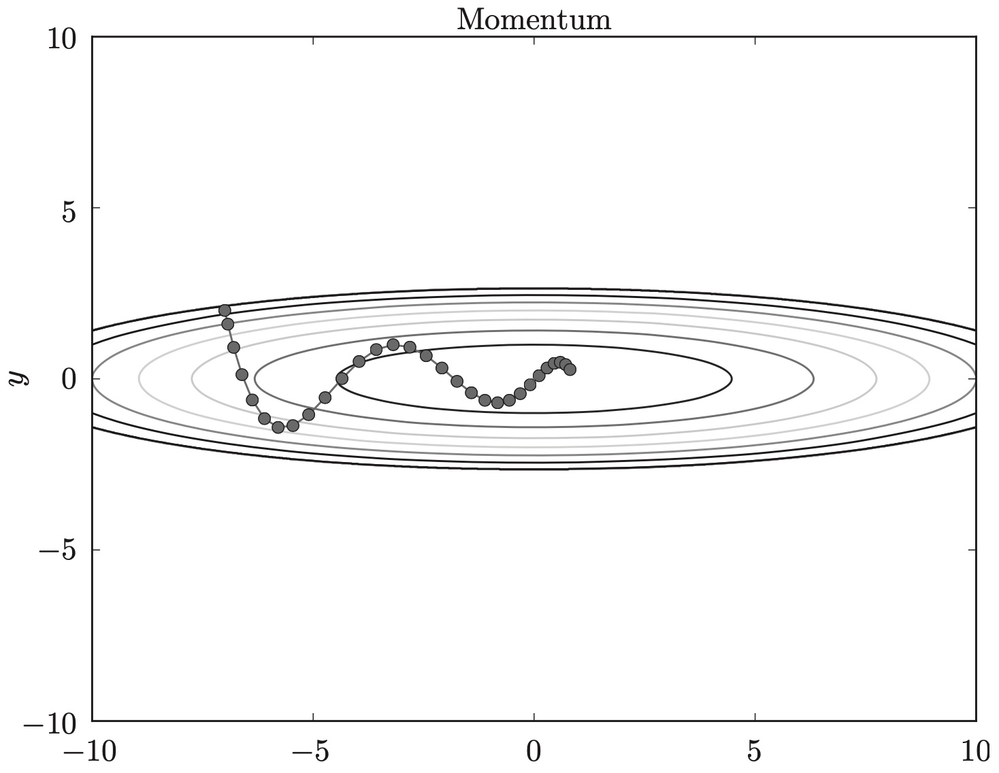
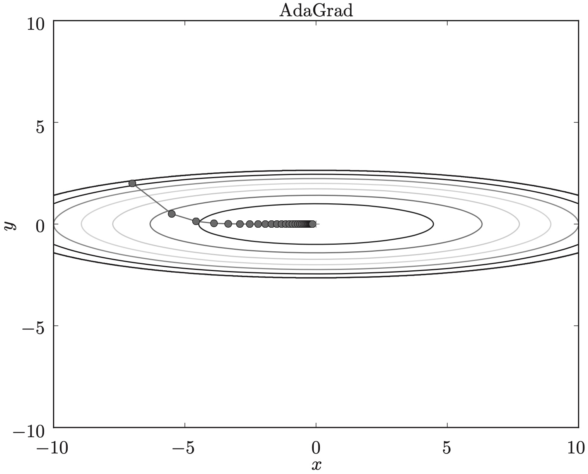
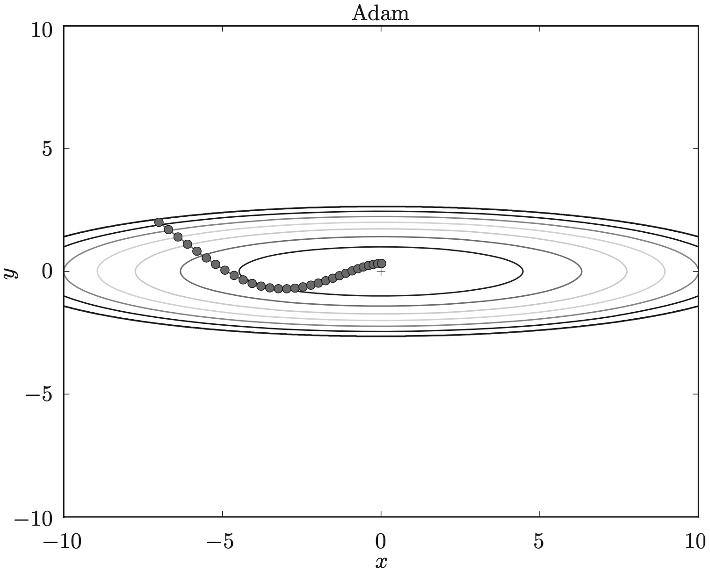
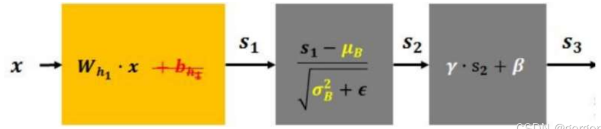
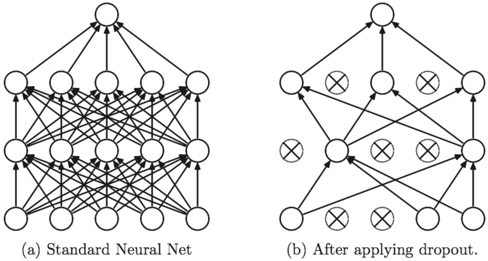

# 学习的相关技巧

> [!tip]
>
> 使用sk-learn的手写数据数据训练神经网络模型。

1. 加载sk-learn的手写数字数据，并显示样例。
2. 对数据进行归一化处理。
3. 将数据划分为训练集测试集，测试集占20%。（这里不用验证集调节超参数。）
4. 将数据集转换为`tensor`类型，可以使用Pytorch训练模型。
5. 是Pytorch工具对数据进行封装。
   * `TensorDataset`将多个张量包装成一个标准的PyTorch数据集，包含特征和标签。
   * `DataLoader`是训练数据的读取器，可以控制每次读取数据的数量。（每批次64条）
6. 使用`Sequential`构建网络，激活函数是Sigmod函数，网络结构为

6. 使用`torchinfo`打印模型信息。
7. 定义交叉熵损失函数。
8. 定义SGD优化器优化器，只设置学习率。
9. 训练模型。保存每个epoch训练集的loss值和准确率。
10. 绘制损失曲线和准确率曲线。
11. 使用测试数据评估模型性能。

## 参数的更新

从训练数据中随机选择数据，进行梯度下降称为随机梯度下降算法，其权重的更新公式如下
$$
W \leftarrow W-\eta\frac{\partial L}{\partial W}
$$

其中$\eta$表示下降的学习率。

> [!warning]
>
> 标准的SGD优化，模型训练的收敛速度相对较慢。

### Momentum

动量优化（Momentum）器的数学公式如下
$$
v\leftarrow \alpha v-\eta\frac{\partial L}{\partial W} \\
W\leftarrow W+ v
$$

* $\alpha$设定为逐渐减速的任务。
* 初始时$v=0$。
* 之后每次下降调用上一次的$v$值。
* 计算梯度的指数加权平均数，并利用该值来更新参数值。

使用Momentum的优化路径示意图

1. 动量通过累积同向加速，使得梯度下降更快。
2. 在震荡方向上累积的梯度会向后抵消。
3. 通过累积惯性会更容易冲过平坦点。

> [!tip]
>
> 在训练过程中增加动量参数。

### AdaGrad

在神经网络的学习中，学习率$\eta$的值很重要：

* 学习率过小，会导致学习花费过多时间；
* 反过来，学习率过大，则会导致学习发散而不能正确进行。

在关于学习率的有效技巧中，有一种被称为学习率衰减的方法，即随着学习的进行，使学习率逐渐减小。AdaGrad会为参数的每个元素适当地调整学习率，数学式表示为
$$
h \leftarrow h+\frac{\partial L}{\partial W} \odot \frac{\partial L}{\partial W} \\
W \leftarrow W - \eta \frac{1}{\sqrt{h}}\frac{\partial L}{\partial W}
$$

* AdaGrad是对学习率进行修正。
* 按参数的元素进行学习率衰减，使变动大的参数的学习率逐渐减小。
* 学习越深入，更新的幅度就越小。如果无止境地学习，更新量就会变为0。

使用AdaGrad的优化路径示意图

> [!tip]
>
> 使用AdaGrad优化器，训练手写数字识别模型。

### Adam

直观地讲，Adam就是融合了Momentum 和AdaGrad的方法。Adam会设置3个超参数：

1. 学习率`lr`，超参数用户选择。
2. 一次momentum系数`beta1`，通常设置为0.9
3. 二次momentum系数`beta2`，通常设置为0.999

> [!important]
>
> Adam优化器即融合的动量，也融合了自适应调节学习率。

使用Adam对的优化路径示意图

> [!tip]
>
> 使用Adam优化器，训练手写数字识别模型。

## 权重的初始值

在神经网络的学习中，权重的初始值特别重要，经常关系到神经网络的学习能否成功。

> [!tip]
>
> 可以将权重初始值设为0吗？

将权重初始值设为0的话，将无法正确进行学习。

在2层神经网络中，假设第1层和第2层的权重为0。

1. 正向传播时，因为输入层的权重为0，所以第2层的神经元全部会被传递相同的值。
2. 第2层的神经元中全部输入相同的值，这意味着反向传播时第2层的权重全部都会进行相同的更新。
3. 第2层的神经元全部会被传递相同的值。

权重被更新为相同的值，这使得神经网络拥有许多不同的权重的意义丧失了。

> [!warning]
>
> 严格地说，不能将权重初始值设成一样的值。

神经网络中权重值的特点：

1. 为了防止“权重均一化”，必须随机生成初始值。
1. 在逻辑回归中为了抑制权重的过拟合，使用了正则项，正则项的目的就是抑制权重过大，所以权重应该是一个很小的值。

> [!important]
>
> 在权重初始化时，初始权重应该是一个较小的随机值。

实践中使用，高斯分布生成的值，乘以0.01后得到的值（标准差为0.01的高斯分布）。

### sigmoid的初始值

sigmoid函数是S型函数，各层的激活值呈偏向0和1的分布。

*  偏向0和1的数据分布会造成反向传播中梯度的值不断变小，最后消失。

* 推荐使用Xavier初始值：如果前一层的节点数为$n$，则初始值使用标准差为$\frac{1}{\sqrt{n}}$的分布。该方法的基本思想是，各层的激活值和梯度的方差在传播过程中保持一致。

> [!tip]
>
> 使用Xavier初始化模型参数。

### ReLU的权重初始值

模型的激活函数可以选择ReLU函数。当激活函数使用ReLU时，一般使用He初始值。

* 使用标准差为$\sqrt{\frac{2}{n}}$的高斯分布。
* ReLU的负值区域的值为0，为了使它更有广度，所以需要2倍的系数。

> [!tip]
>
> 修改模型激活函数为ReLU，并使用He初始化。

## 正则化

> [!important]
>
> 神经网络学习出来的参数就是一系列非常小的数值，但又不是0。

### Batch Normalization

Batch Norm就是以进行学习时的mini-batch为单位，按mini-batch进行归一化。

每行表示一个样本，每列表示一个特征，Batch Norm归一化就对一个mini-batch的数据每一列进行归一化。Batch Norm层会对正规化后的数据进行缩放和平移的变换，公式为
$$
f(x)=\gamma\cdot\frac{x-\text{E}(x)}{\sqrt{\text{Var}(x)}+\epsilon}+\beta
$$
1. $\gamma$和$\beta$是可学习的参数，它相当于对标准化后的值做了一个线性变换，$\gamma$为系数，$\beta$为偏置。

> [!important]
>
> $\gamma$和$\beta$这两个学习参数可以自适应调节分布形态，是BN层的精髓。

2. $\epsilon$通常为1e-5，避免分母为0。
3. $\text{E}(x)$表示变量的均值。
4. $\text{Var}(x)$表示变量的方差。

> [!important]
>
> 建议BN层被插入在激活层前面。

Batch Norm方法的优点：可以增大学习速率；不那么依赖初始值；抑制过拟合。

> [!tip]
>
> 在ReLU激活函数模型中增加BN层。

### L2正则

正则项可以控制权重的无限增大，可以用于抑制过拟合，在深度学习中同样有效。

> [!warning]
>
> 正则化会使BN层的$\gamma$和$\beta$趋向于0，失去其存在的意义，所以BN层一般不进行正则化。

优化器直接内置L2正则化选项。 

> [!tip]
>
> 在优化器中添加正则项，避开BN层。

### Dropout

Dropout是一种在学习的过程中随机删除神经元的方法。训练时，随机选出隐藏层的神经元，然后将其删除。被删除的神经元不再进行信号的传递，示意图如下

* 训练时，每传递一次数据，就会随机选择要删除的神经元；
* 测试时，虽然会传递所有的神经元信号，但是对于各个神经元的输出，要乘上训练时的删除比例后再输出。

> [!important]
>
> Dropout层一般与全连接层结合使用，放在激活函数后面。

Dropout可以理解为

* 通过在学习过程中随机删除神经元，从而每一次都让不同的模型进行学习。
* 可以看成机器学习中的集成学习，集成模型一般优于单一模型，因为它们可以捕获更多的随机性。
* Dropout将集成学习的效果通过一个网络实现了。

> [!tip]
>
> 在ReLU激活函数模型中增加Dropout层。

## 超参数的选择

超参数的值设置合适，模型的性能就会很好，且训练速度快，但在决定超参数的过程中一般会伴随很多的试错。进行超参数的最优化时，逐渐缩小“合适”超参数的范围。优化步骤如下：

1. 设定超参数的范围（大致设定一个范围）。
2. 从设定的超参数范围中随机采样。
3. 使用步骤2中采样到的超参数的值进行学习，通过验证数据评估识别精度（但是要将epoch设置得很小）。
4. 重复步骤2和步骤3（ 100 次等），根据它们的识别精度的结果，缩小超参数的范围。

反复进行上述操作，不断缩小超参数的范围，在缩小到一定程度时，从该范围中选出一个超参数的值。这就是进行超参数的最优化的一种方法。

> [!caution]
>
> 不能使用测试数据，评估超参数的性能。

### 统计错误数据

> [!tip]
>
> 统计sk-learn手写数字识别的测试集的错误数据。

1. 打印测试数据的混淆矩阵。
2. 统计识别错误的数据。
3. 打印错误样本包括：图像、原始标签、模型分类结果。
