# 卷积神经网络

> [!tip]
>
> 全连接层在图像分类中存在哪些问题？

1. 需要处理的数据量大、效率低。
2. 图像在维度调整的过程中很难保留原有的特征，导致图像处理的准确率不高。

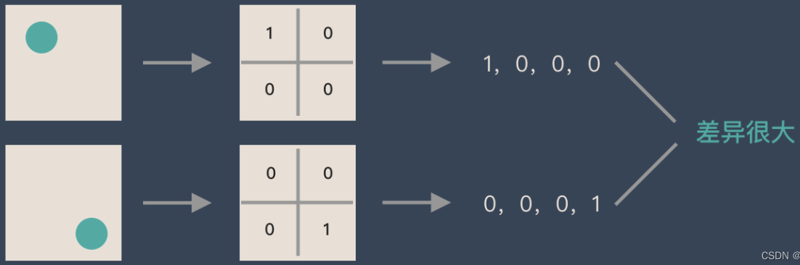

图像通常是高、长、通道方向上的 3 维形状。

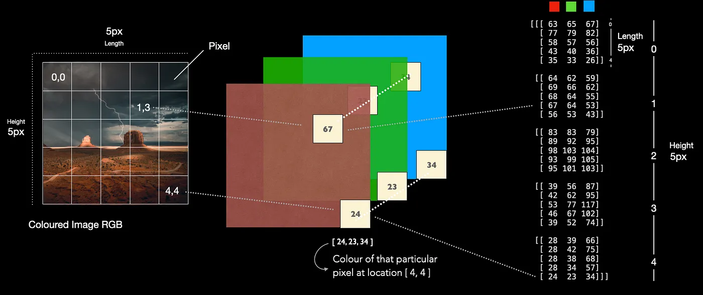

* 全连接层输入时，需要将3维数据变换为1维数据。这样处理会忽视形状，将全部的输入数据作为相同的神经元处理。

卷积神经网络（Convolutional Neural Network，CNN）受人类视觉神经系统的启发，设计的神经网络：

1. 从原始信号摄入开始（瞳孔摄入像素 Pixels）。
2. 接着做初步处理（大脑皮层某些细胞发现边缘和方向）。
3. 然后抽象（大脑判定，眼前的物体的形状，是圆形的）。
4. 最后，进一步抽象（大脑进一步判定该物体是只人脸）。

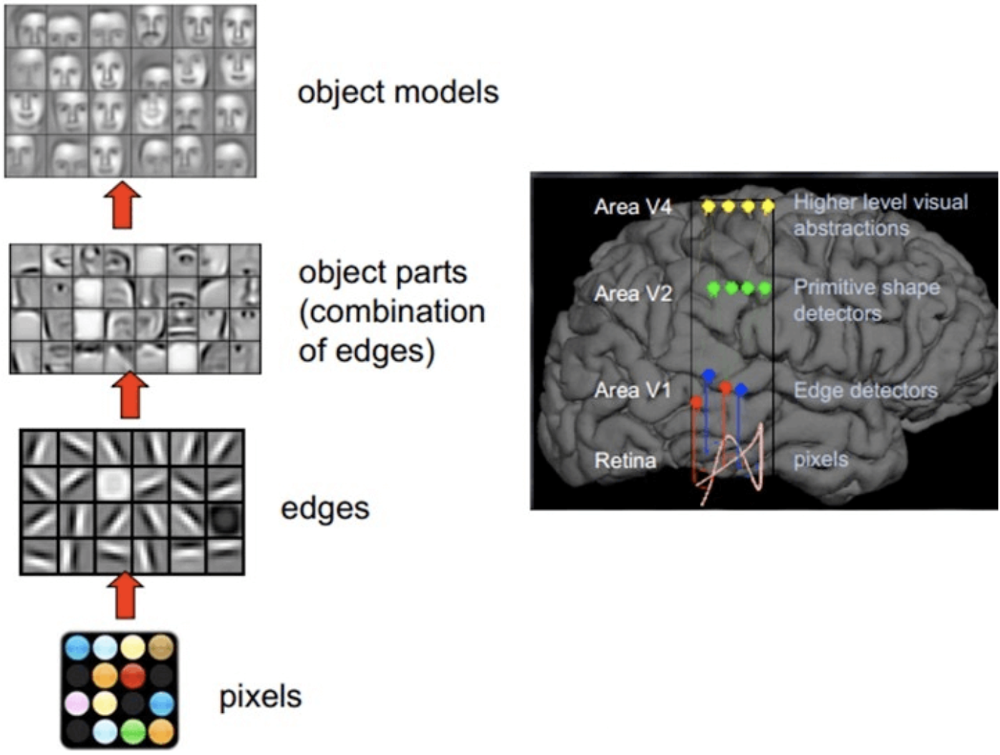

CNN主要用于图像识别。在卷积神经网络中增加了卷积层（Convolution层）和池化层（Pooling层）。全连接网络和卷积神经网络的对比如下

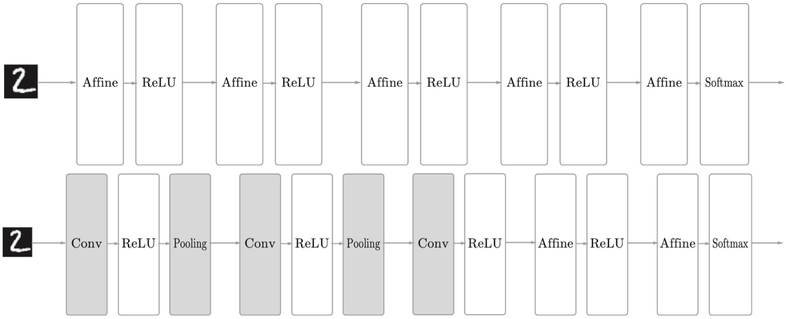

## 卷积层

卷积层是卷积神经网络中的核心模块，卷积层的本质是滑动滤波器，目的是提取输入特征图的特征。

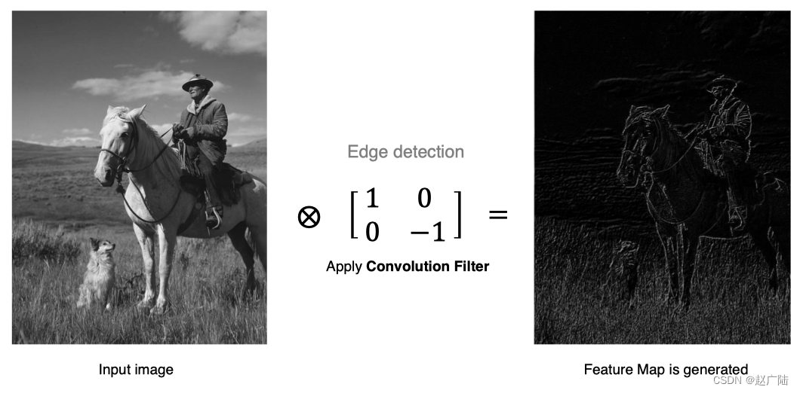

### 卷积运算

卷积运算是将滤波器在图像上移动

- 将各个位置上滤波器元素和输入对应元素相乘，然后再求和。
- 将这个结果保存到输出的对应位置。
- 在滤波数据加上偏置。

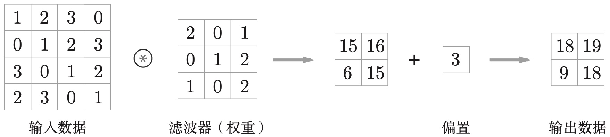

### 填充

在进行卷积层的处理之前，有时要向输入数据的周围填入固定的数据，这称为填充（padding）。

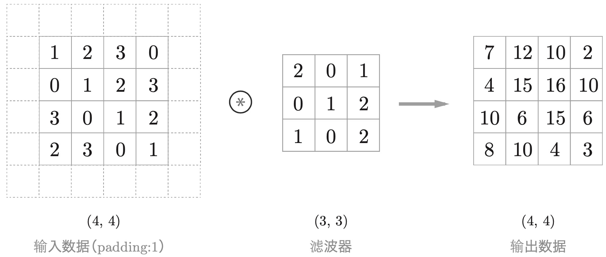

> [!important]
>
> 卷积中使用填充，主要是为了调整输出的大小，保持空间大小不变的情况下，将数据传给下一层。

### 步幅

滤波器移动的距离长度称为步幅（stride），步幅也可以用于压缩特征。

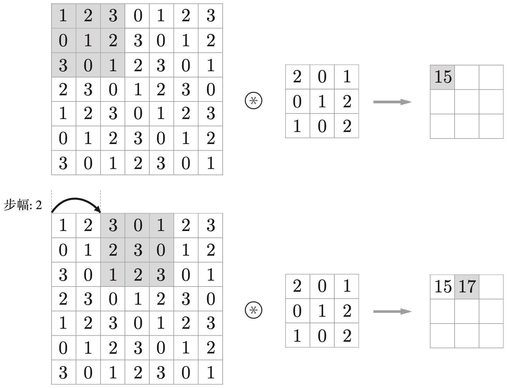

假设输入图像的宽为$W$、高为$H$，滤波器宽为$FW$、高为$FH$，填充为$P$，步幅为$S$，输出大小宽为$OW$、输出高为$OH$。则输出图像大小计算公式为

$$
\begin{aligned} 
OH & =\frac{H+2P-FH}{S}+1 \\
OW & =\frac{W+2P-FW}{S}+1 \\
\end{aligned}
$$

### 三维数据的卷积

多通道图像进行卷积时，使用多个特征图，按通道进行滤波器的卷积运算，并将结果相加，从而得到输出。

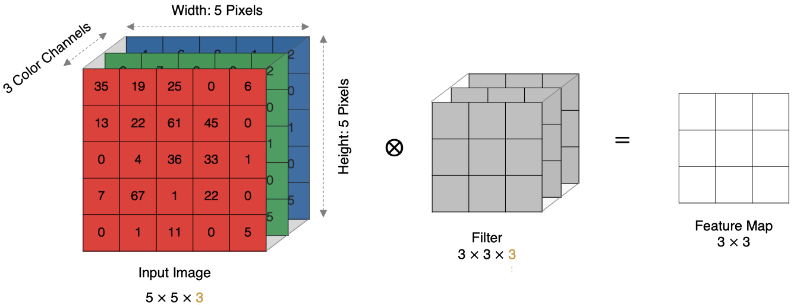

计算过程如下

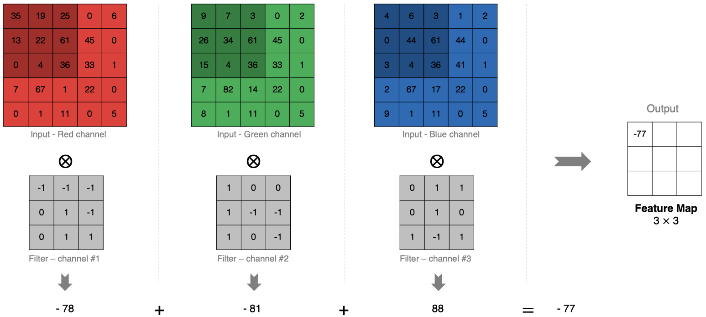

在多维数据的卷积运算中，输入数据和滤波器的通道数要设为相同的值。卷积后输出的结果是二维图像

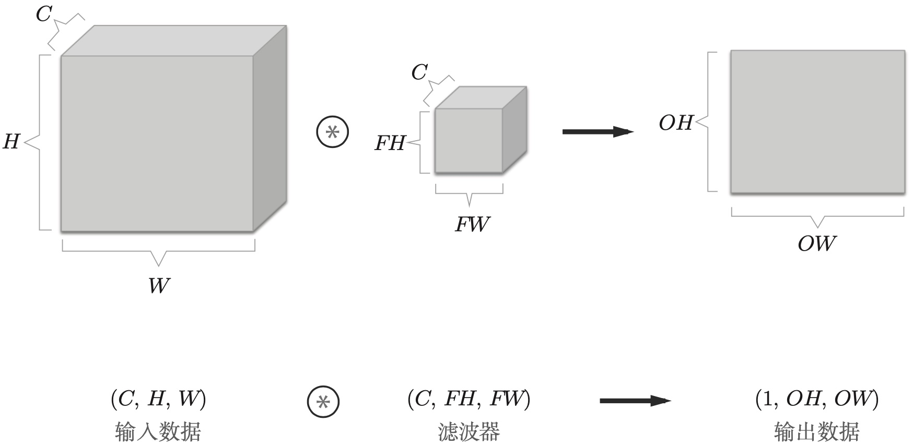

卷积处理后的图像称为特征图。当有多个滤波器时生成特征图过程为

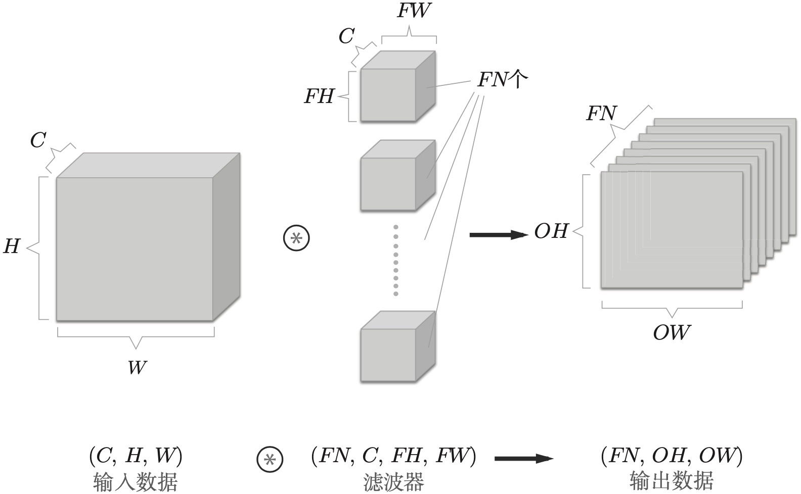

给特征图增加偏置之后为

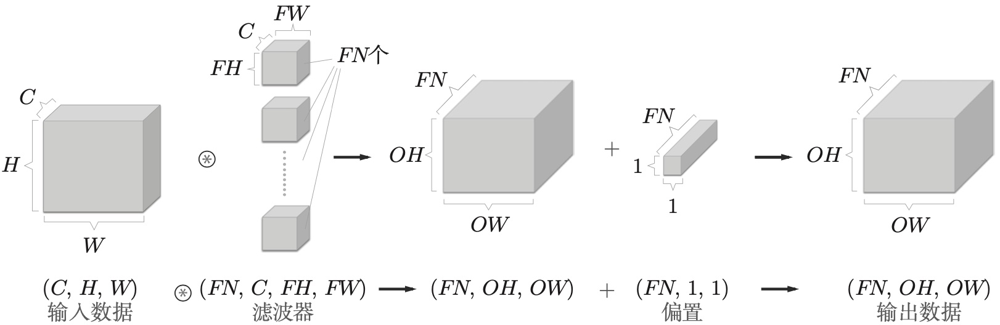

> [!important]
>
> CNN的训练过程，就是要确定各个滤波器上的最优参数。

感受野（Receptive Field）是指神经网络中神经元看到的输入区域。在卷积神经网络中，特征图上某元素的计算，受输入图像上一定区域的影响，即为该元素的感受野。

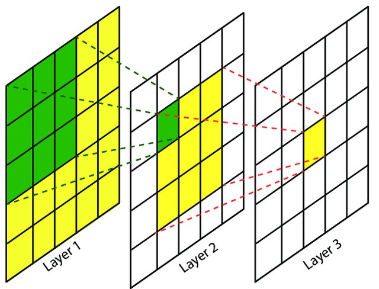

- 卷积过程就是逐渐增加感受野的范围。

> [!warning]
>
> 卷积层一般是使通道数变大。

## 池化层

池化是缩小高、长方向上的空间的运算。用于降低图像维度。

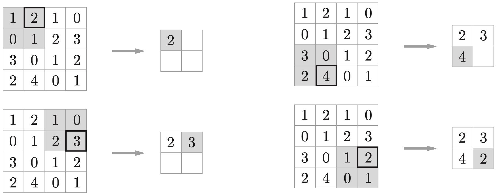

假设输入图像的宽为$W$、高为$H$，池化宽为$KW$、高为$KH$，填充为$P$，步幅为$S$，输出大小宽为$OW$、输出高为$OH$。池化后图形的大小为
$$
\begin{aligned} 
OH & =\frac{H+2P-KH}{S}+1 \\
OW & =\frac{W+2P-KW}{S}+1 \\
\end{aligned}
$$

池化的方法包括：

- Max池化是从目标区域中取出最大值。
- Average池化是计算目标区域的平均值。

池化的特点：

- 池化层没有要学习的参数。
- 经过池化运算，输入数据和输出数据的通道数不会发生变化。
- 对微小的位置变化具有鲁棒性。

> [!warning]
>
> 池化层一般是使特征图变小。

## 全连接层

全连接层位于CNN网络的末端，经过卷积层的特征提取与池化层的降维后，将特征图转换成一维向量送入到全连接层中进行分类或回归的操作。

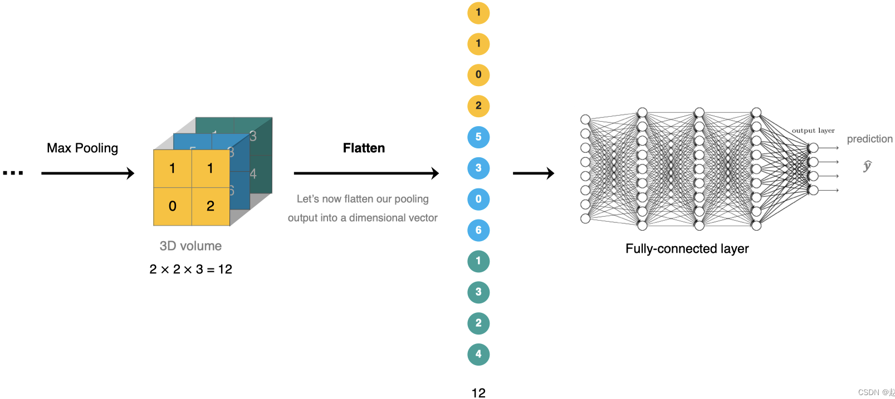

## PyTorch API

### 卷积层

卷积实际计算是，将输入图像按照卷积滤波器的要求展开成矩阵形式。

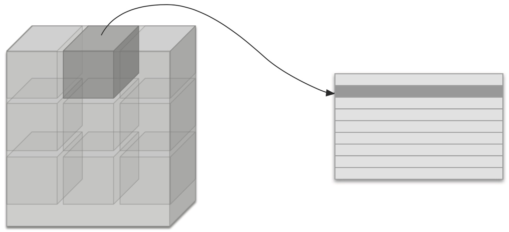

数据展开后卷积计算会转换成矩阵乘法

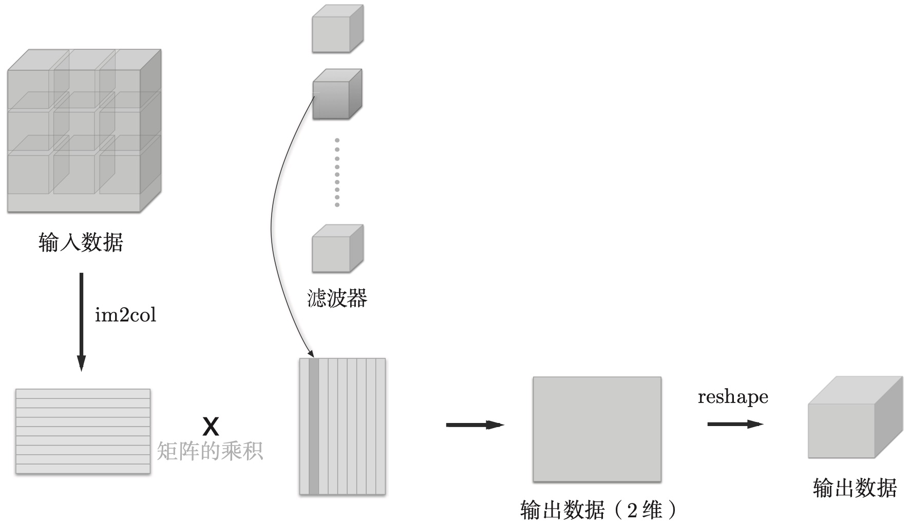

PyTorch中[`nn.Conv2d`](https://docs.pytorch.org/docs/stable/generated/torch.nn.Conv2d.html#torch.nn.Conv2d)实现了卷积层

```python
nn.Conv2d(in_channels, out_channels, kernel_size, stride, padding)
nn.Conv2d(1, 6, 3, 1, 'same')
```

- `in_channels`输入图像的通道数量。
- `out_channels`输出图像的通道数量（卷积核的数量）。
- `kernel_size`卷积核的大小。
- `stride`卷积核的步长。
- `padding`边界填充值。

### 池化层

池化的应用区域按通道单独展开。反向传播时，梯度只会传递到最大值的位置，其他位置的梯度为0。

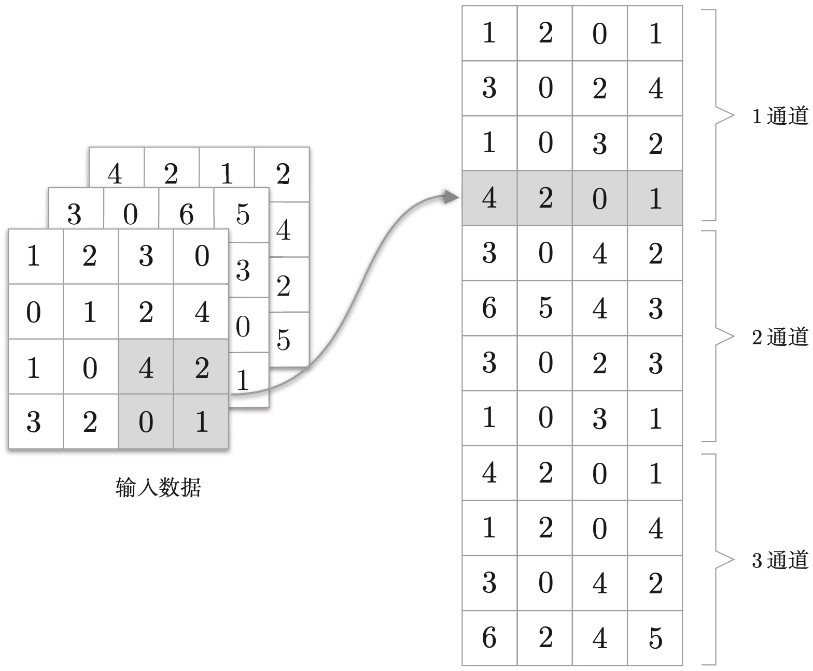

PyTorch中[`nn.MaxPool2d`](https://docs.pytorch.org/docs/stable/generated/torch.nn.MaxPool2d.html#torch.nn.MaxPool2d)实现了最大池化

```python
nn.MaxPool2d(kernel_size, stride)
nn.MaxPool2d(2, 1)
```

- `kernel_size`池化层大小。
- `stride`窗口移动的步长。

PyTorch中[`nn.AvgPool2`](https://docs.pytorch.org/docs/stable/generated/torch.nn.AvgPool2d.html#avgpool2d)平均池化

```python
nn.AvgPool2d(2, 2)
```

### 使用AutoDL的GPU

PyTorch可以使用简单命令，实现模型训练的GPU加速。[AutoDL](https://www.autodl.com/home)是专注于AI与深度学习领域的GPU云算力租赁与服务平台。

[AutoDL如何租用算力？](https://www.autodl.com/docs/quick_start/)

是Trae远程连接服务器

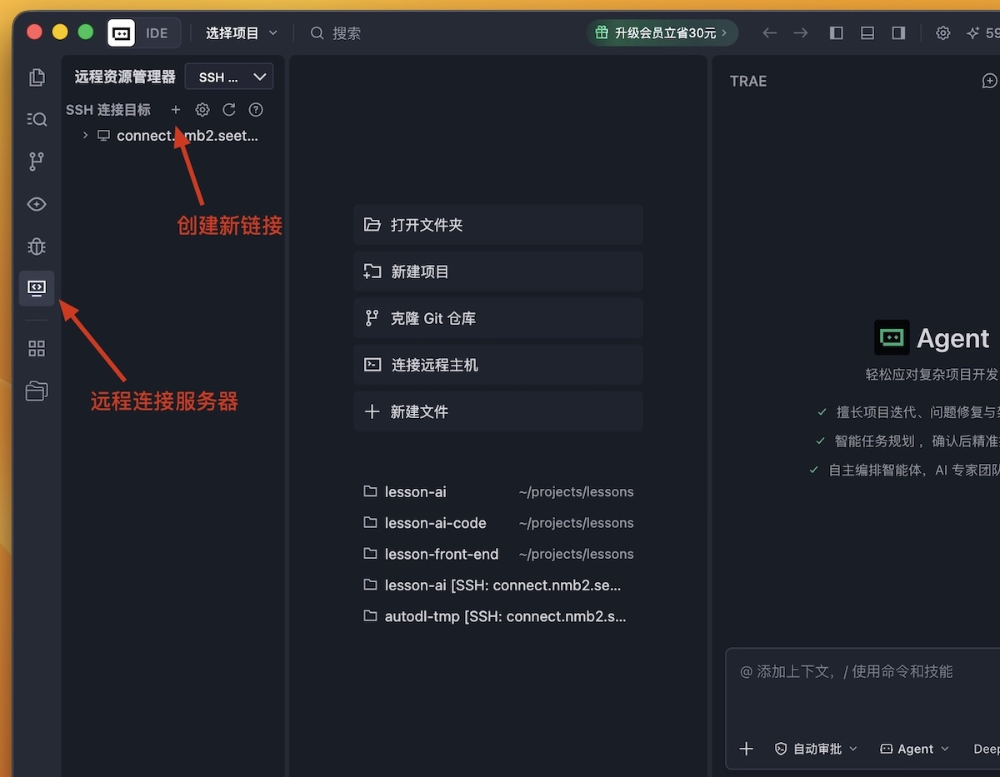

输入用户名密码

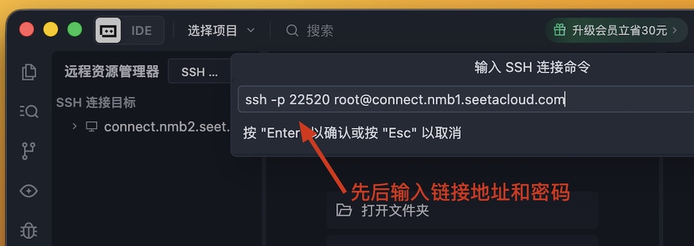

选择工作目录

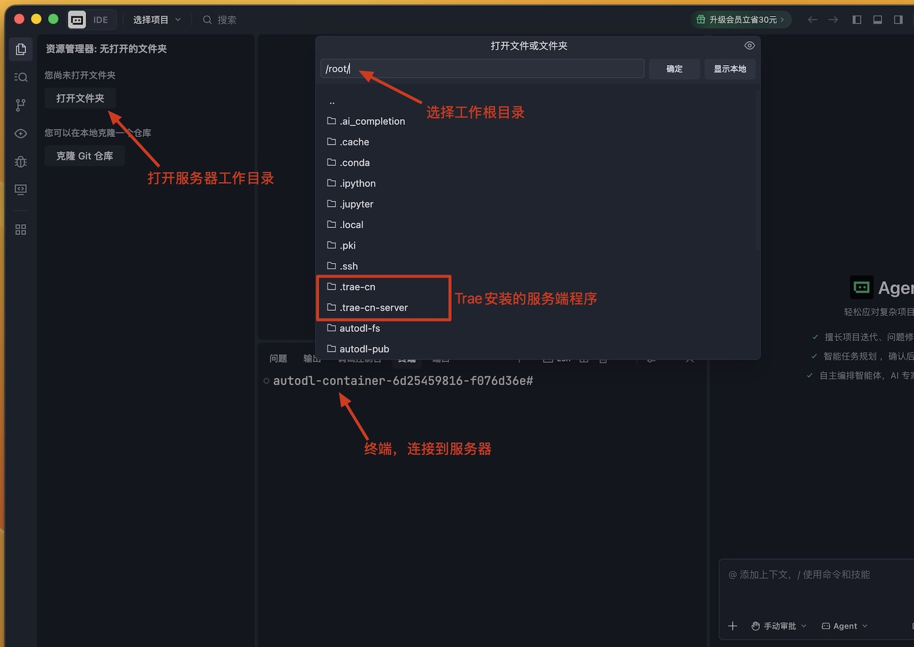

插件需要再服务端重新安装

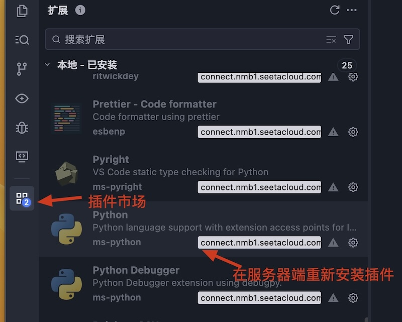

初始化服务器要点：

1. 镜像创建成功后需要保存镜像。
   * 下次新建服务器可以选择以保存的镜像，避免重新配置。
   * AutoDL有免费的30G系统镜像。
2. 编写代码时，可以关闭服务器，让后选择无卡模式开机，进行开发。
   * 无卡模式开机价格极低。
   * 无卡模式同时会限制CPU的数量，在无卡模式下初始化环境，系统极慢。
3. 开发完成后，带卡重新启动，运行程序。
4. 使用Trae链接服务器进行开发，AI使用的是本地能力与服务器无关。

[AutoDL容器文件目录](https://www.autodl.com/docs/env/)

服务器使用要点

* 开发代码放在`/root/autodl-tmp`目录下。
* 备份数据集放在`/root/autodl-fs`目录下。
* 开发代码一般同步到Git仓库中。

[使用镜像加速](https://www.autodl.com/docs/network_turbo/)

> [!caution]
>
> 使用Trae生成代码时，会默认在沙盒中测试代码，AutoDL在无卡模式下内存不足以支持沙盒运行。

## CNN网络实现

### MNIST数据集

MNIST数据集是用手写数字识别的数据集，该数据集包含60000个用于训练的样本和10000个用于测试的样本，图像是固定大小（$28\times 28$像素），其值为0到255。sklearn中的`load_digits`是该数据集的子集。

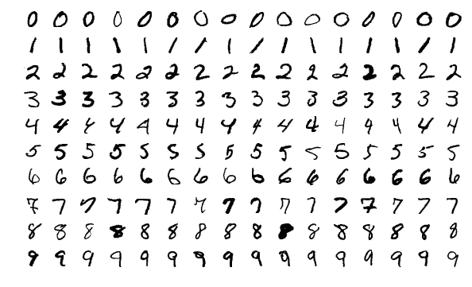

> [!tip]
>
> 加载MINST数据，并加载到`DataLoader`中。

使用`DataLoader`加载数据后，数据集会按批准处理，数据的形状为

```shell
[batch, channels, height, width] => [64, 1, 28, 28]
```

### LeNet

LeNet是1989年，贝尔实验室的研究员Yann LeCun提出的，进行手写数字识别的网络，这是现代卷积神经网络的鼻祖。1998年，LeNet进行了改进，形成了现在通用的LeNet-5。

> [!important]
>
> 卷积神经网络中，统计网络层数，只计算卷积层和全连接层。

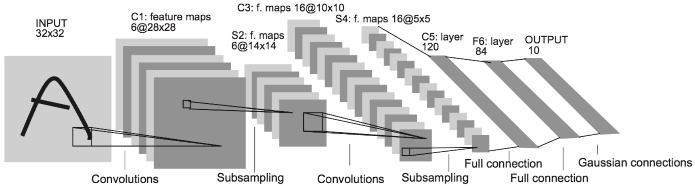

LeNet的特点：

1. 一共有7层，两个卷积层，两个池化层，两个全连接层，一个输出层。
2. 使用sigmoid函数，为激活函数。
3. 使用$5\times 5$大小的卷积核。
4. 使用子采样（subsampling）缩小中间数据的大小。

> [!important]
>
> 在卷积神经网络中，卷积层的功能是特征提取，全连接层的功能是分类。

### 子类构建模型

PyTorch构建网络的另一种方式为继承，继承`nn.Module`类，在`__init__`函数中定义网络层，在`forward`方法中定义网络的前向传播过程。

```python
from torch import nn

class LeNet(nn.Module):
    def __init__(self):
        super(LeNet, self).__init__()

        self.c1 = nn.Conv2d(in_channels=1, out_channels=6, kernel_size=5, padding=2)
        self.p1 = nn.AvgPool2d(kernel_size=2, stride=2)
        self.c2 = nn.Conv2d(in_channels=6, out_channels=16, kernel_size=5)
        self.p2 = nn.AvgPool2d(kernel_size=2, stride=2)

        self.flatten = nn.Flatten()
        self.f1 = nn.Linear(16 * 5 * 5, 120)  # 16 channels * 5x5 feature map
        self.f2 = nn.Linear(120, 84)
        self.f3 = nn.Linear(84, 10)

    def forward(self, x):
        x = nn.Sigmoid()(self.c1(x))
        x = self.p1(x)
        x = nn.Sigmoid()(self.c2(x))
        x = self.p2(x)
        x = self.flatten(x)
        x = nn.Sigmoid()(self.f1(x))
        x = nn.Sigmoid()(self.f2(x))
        x = self.f3(x)
        return x
```

> [!tip]
>
> 创建LeNet用于MINST数据分类，使用`torchinfo`打印模型结构。

### 模型训练

> [!tip]
>
> 根据如下要求训练LeNet模型。

1. 使用Adam优化器。
2. 批次数量128。
3. 自主选择最大轮数和学习率。
4. 根据设备条件自动选择GPU和CPU。
5. 训练过程中，可以实时打印训练的进度条。
6. 记录训练集的损失曲线和准确率曲线，训练完成后使用matplotlib绘制，保存图像文件。
7. 统计测试集的准确率。

### 退火优化

退火函数（Annealing）主要用于动态调整学习率，以优化模型训练过程。退火函数的优势有

- 逃离局部最优：通过动态调整学习率，帮助模型跳出局部最小值，寻找全局最优解。
- 加速收敛：初期使用较大学习率快速下降，后期减小学习率精细调参。
- 稳定训练：避免后期因学习率过大导致损失震荡。

常见的退火函数有：固定步长衰减、指数衰减、余弦退火、线性衰减。训练过程中可以首选余弦退火，余弦退火的特点是过度平滑

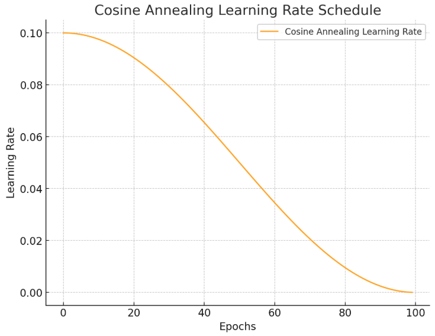

> [!tip]
>
> 在训练过程中增加余弦退火函数。

### 保存模型

> [!tip]
>
> 保存训练过程中的最优模型，并完成如下任务。

1. 读取最优模型，评价测试集的准确率。
2. 使用最优模型绘制测试的混淆矩阵。
3. 统计测试集中的错误样本。
4. 使用matplotlib错误数据图片，包括真实标签和分类标签。

### CNN网络的可视化

学习前的滤波器是随机进行初始化的，所以在滤波器图像没有规律可循，但学习后的滤波器变成了有规律的图像，如：从白到黑渐变的滤波器、含有块状区域的滤波器等。

> [!important]
>
> 卷积层的滤波器可以看作，用于提取边缘或斑块等信息。

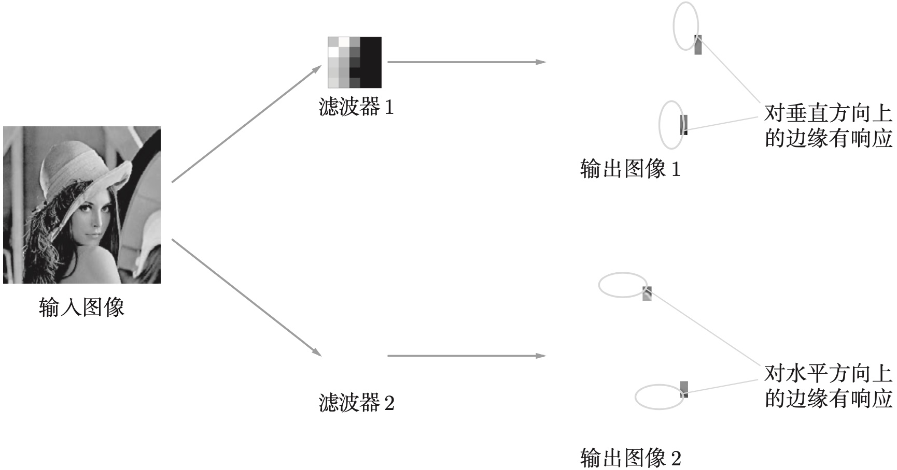

> [!tip]
>
> 可视化卷积层。
