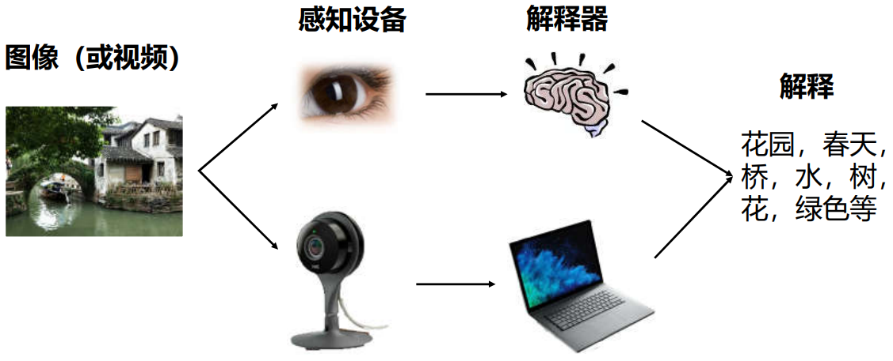
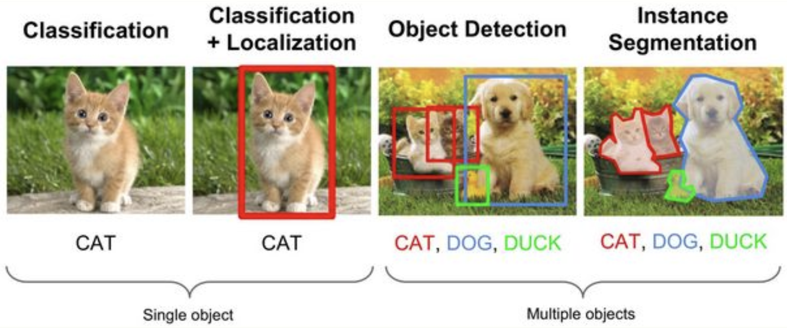
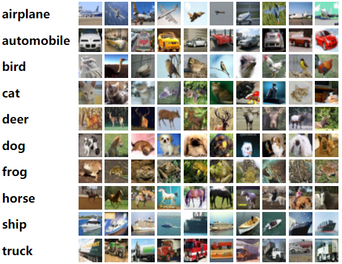
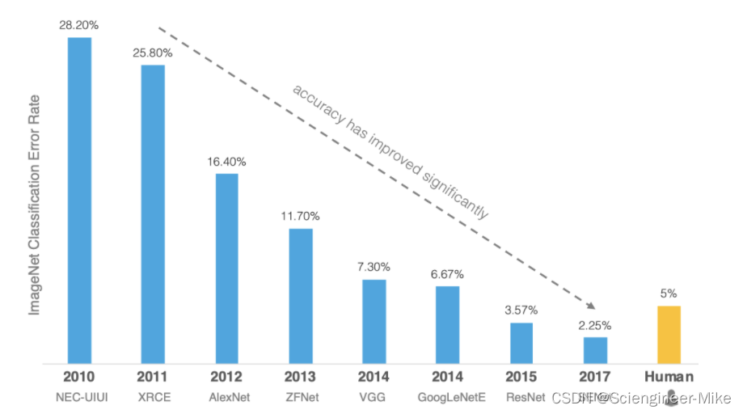

# 简介

计算机视觉是指用摄像机和电脑及其他相关设备，对生物视觉的一种模拟，它的主要任务让计算机理解图片或者视频中的内容。

计算机视觉的目标可以拆分为：

* 让计算机理解图片中的场景（办公室，教室等）
* 让计算机识别场景中包含的物体（交通工具，人等）
* 让计算机定位物体在图像中的位置（物体的大小，边界等）
* 让计算机理解物体之间的关系或行为，以及图像表达的意义。

应用常见：

1. 人脸识别：人脸识别技术广泛应用于金融、司法、军队、公安、边检、政府、航天、电力、工厂、教育、医疗等行业。
2. 视频监控：在大量人群流动的交通枢纽，用于人群分析、防控预警等。
3. 图片识别分析：主要应用是以图搜图，物体分析。
4. 辅助驾驶：在辅助驾驶领域机器视觉是重要的手段。

## 常见任务

计算机视觉目标任务的分解，可将其分为三大经典任务：图像分类、目标检测、图像分割。

- 图像分类（Classification）：将图像结构化为某一类别，用事先确定好的类别（category）来描述图片。
- 目标检测（Detection）：关注特定的物体目标，要求同时获得这一目标的类别信息和位置信息。
- 图像分割（Segmentation）：分割是对图像的像素级描述，需要找打目标物体在图像中的边界。

## 图像分类简介

图像分类就是从给定的类别集合中，为图像分配对应标签的任务，即：分析一个输入图像，并返回一个该图像类别的标签。

假定类别集为$\text{categories} = \{\text{dog}, \text{cat}\}$，输入一张图片

模型对图片的分类结果$\text{dog}=95\%$和$\text{cat}=5\%$，根据概率的大小将图片分类为dog类。

### 常用数据集

1. [Fashion-MNIST](https://docs.pytorch.org/vision/main/generated/torchvision.datasets.FashionMNIST.html)是一个替代MNIST手写数字集的图像数据集。 

   * 涵盖了来自10种类别的共7万个不同商品的正面图片。
   * 图片为28x28的灰度图片。
   * 使用PyTorch可以下载该数据集。

2. CIFAR数据集分为CIFAR-10和CIFAR-100两类数据

   * CIFAR-10数据集5万张训练图像、1万张测试图像、10个类别、每个类别有6k个图像，图像大小32×32×3。

   * CIFAR-100数据集也是有5万张训练图像、1万张测试图像、包含100个类别、图像大小32×32×3。
   * PyTorch中可以直接加载该数据集。

3. ImageNet数据集是ILSVRC竞赛使用的是数据集。
   * 由斯坦福大学李飞飞教授主导，包含了超过1400万张全尺寸的有标记图片，大约有22000个类别的数据。
   * ILSVRC是视觉领域最具权威的学术竞赛之一。从2010年开始举办到2017年最后一届。
   * 使用ImageNet数据集的一个子集，总共有1000类。

ILSVRC的获胜者从2012年开始都是使用的深度学习的方法

## 模型的评价标准

| 任务类型                 | 合理泛化差距（训练-验证） | 说明                                     |
| :----------------------- | :------------------------ | :--------------------------------------- |
| 简单任务（如MNIST）      | < 2%                      | 数据简单，模型容易拟合，差距应非常小     |
| 中等任务（如CIFAR-10）   | 2% - 5%                   | 数据复杂度中等，允许一定差距             |
| 复杂任务（如ImageNet）   | 5% - 10%                  | 数据复杂，模型容量大，差距可能较大       |
| 高噪声任务（如医学图像） | 10% - 15%                 | 数据噪声大，标签可能不准确，允许较大差距 |

