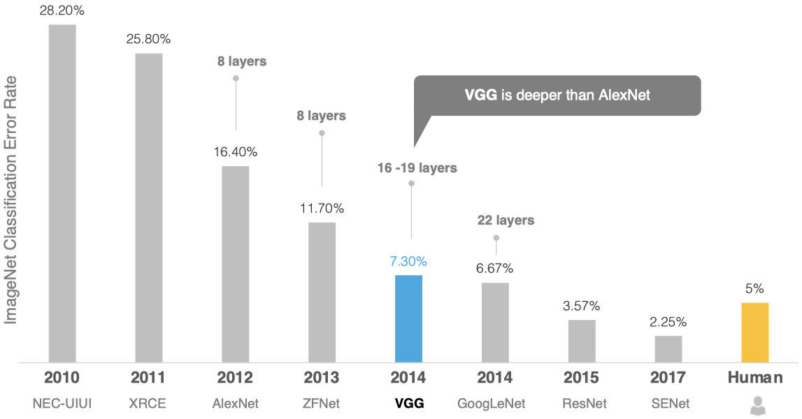
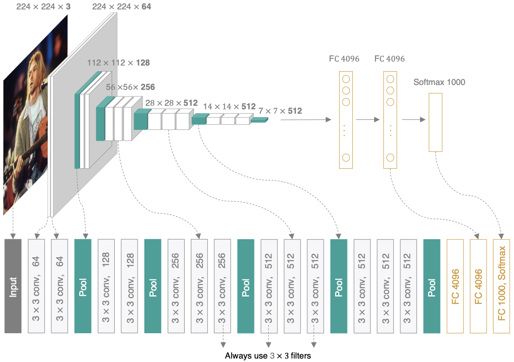
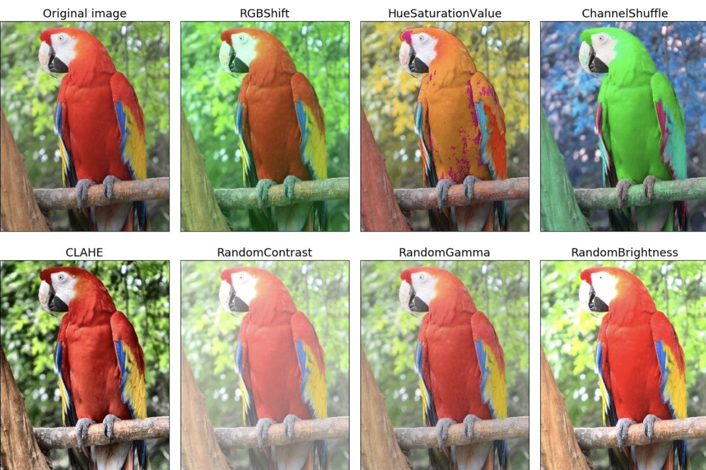

# VGGNet

2014年，牛津大学计算机视觉组（Visual Geometry Group）和Google DeepMind公司的研究员一起研发出了新的深度卷积神经网络：VGGNet，并取得了ILSVRC2014比赛分类项目的第二名，主要贡献是使用很小的卷积核$(3\times 3)$构建卷积神经网络结构，能够取得较好的识别精度，常用来提取图像特征的VGG-16和VGG-19。



相关论文：[Very Deep Convolutional Networks for Large-Scale Image Recognition](https://arxiv.org/pdf/1409.1556)

VGG可以看成是加深版的AlexNet，整个网络由卷积层和全连接层叠加而成。和AlexNet不同的是，VGG中使用的都是小尺寸的卷积核。



VGGNet的主要改特点：

1. 更深的网络结构。VGGNet 的一个主要特点是其深度，通常有16到19层。通过增加网络深度，提高了模型的表达能力，可以学习到更复杂的特征。
2. 更小的卷积核。VGGNet 使用了3x3的卷积核。VGGNet认为，多个3x3的卷积核串联起来可以达到与大卷积核相同的感受野，但参数量更少，计算效率更高。
3. 连续的卷积层。VGGNet使用了多个连续的3x3卷积层。这种连续的卷积层可以更好地提取图像的局部特征，并减少参数量。
4. 更小的步幅。VGGNet使用了1个像素的步幅。更小的步幅可以保留更多的图像信息，提高模型的准确性。
5. 更多的池化层。VGGNet使用了更多的最大池化层，可以有效地减少特征图的尺寸，降低计算量，并提高模型的鲁棒性。
6. 使用ReLU激活函数。
7. 基于Adam的最优化。
8. 使用He初始值作为权重初始值。

> [!warning]
>
> VGG网络最大的特点就是结构简洁，常用于各种后端应用的网络骨架。

## Vgg网络验证

使用Cifar数据集验证Vgg-16网络性能。

### 构建网络

Cifar数据集图层尺寸为$32\times 32$参考Vgg-16构建网络结构，应在全连接层对模型进行调整

| 阶段     | 操作                 | 输出维度 |
| :------- | :------------------- | :------- |
| 输入图像 | —                    | 32×32    |
| Block 1  | 2×Conv3-64+MaxPool2  | 16×16    |
| Block 2  | 2×Conv3-128+MaxPool2 | 8×8      |
| Block 3  | 3×Conv3-256+MaxPool2 | 4×4      |
| Block 4  | 3×Conv3-512+MaxPool2 | 2×2      |
| Block 5  | 3×Conv3-512+MaxPool2 | 1×1      |
| FC       | Linear-512           | 1        |
| FC       | Linear-10            | 1        |

### 创建VGG网络

VGG网络可以看做由多个VGG模块构成，构建整个网络前，可以定义VGG的模块。

> [!note]
>
> 创建Vgg模块，并使用Vgg模块构建Vgg-16网络，网络参数是He初始化。

### 训练模型和优化

> [!note]
>
> 使用Adam优化器训练Vgg-16网络。

模型的优化方法：

1. 增加正则化方法，并适当增加训练次数。
2. 增加早停函数，当测试集分数没有提高时停止训练，避免过拟合。
3. 增加退火策略，使用余弦退火。
4. 在卷积模块后面增加BN层，在全连接后面增加Dropout层。（注意：不要对BN层进行正则化处理）

| 优化                 | 参数                                                         | 准确率 |
| -------------------- | ------------------------------------------------------------ | ------ |
| 基本训练             | EPOCHS=10，BATCH_SIZE=128，LR=1e-4                           | 74.70% |
| 增加正则化和早停函数 | EPOCHS=50，BATCH_SIZE=128，LR=1e-4，WEIGHT_DECAY=1e-2        | 76.12% |
| 正确余弦退火         | EPOCHS=50，BATCH_SIZE=128，LR=1e-4，WEIGHT_DECAY=1.5e-2      | 78.70% |
| 增加BN层和Dropout层  | EPOCHS=70，BATCH_SIZE=128，LR=1e-3，WEIGHT_DECAY=1.5e-2，<br>DROPOUT= 0.5 | 85.18% |
| 增加BN层和Dropout层  | EPOCHS=75，BATCH_SIZE=128，LR=1e-3，WEIGHT_DECAY=1e-3，<br/>DROPOUT= 0.5 | 88.61% |

## 图像增强

为了在有限的数据集上增加训练数据容量，可以采用图像增强技术。

* 对图像进行不同方式的裁剪，物体出现在不同位置，从而减轻模型对物体位置的依赖性。
* 可以调整亮度、色彩等因素来降低模型对色彩的敏感度。

图像增强（image augmentation）指通过剪切、旋转、反射、翻转变换、缩放变换、平移变换、尺度变换、对比度变换、噪声扰动、颜色变换等，一种或多种组合变换来增加数据集的大小。通过对训练图像做一系列随机改变，来产生相似但又不同的训练样本，从而扩大训练数据集的规模。同时，随机改变训练样本可以降低模型对某些属性的依赖，从而提高模型的泛化能力

### 图像增强的方法

图像增强方式可以分为两类：几何变换类和颜色变换类。

1. 几何变换类。主要是对图像进行几何变换操作，包括：翻转，旋转，裁剪，变形，缩放等。


2. 颜色变换类。指通过模糊、颜色变换、擦除、填充等方式对图像进行处理。



针对Cifar-10数据集，有效的图像增强技术是：水平翻转、随机裁剪和颜色扰动。

> [!note]
>
> 尝试使用图像增强的数据集，训练Vgg-16的网络。

| 优化                                            | 参数                                                         | 准确率 |
| ----------------------------------------------- | ------------------------------------------------------------ | ------ |
| 图像增强、正则化、余弦退火和增加BN层和Dropout层 | EPOCHS=200，BATCH_SIZE=256，<br/>LR=1e-3，WEIGHT_DECAY=5e-3，<br/>DROPOUT= 0.5 | 91.89% |

## 处理自定义数据集

### 读取训练数据

使用PyTorch的`ImageFolder`工具处理自己分类数据，数据集组织结构如下

```
owner_data
├── test
│   ├── cat
│   ├── dog
│   └── forg
└── train
    ├── cat
    ├── dog
    └── forg
```

[ImageFolder使用方法](https://juejin.cn/post/7223988948069302329)

### 使用模型推理

> [!note]
>
> 使用网上下载的数据测试模型的分类效果。
