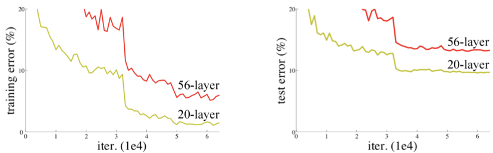
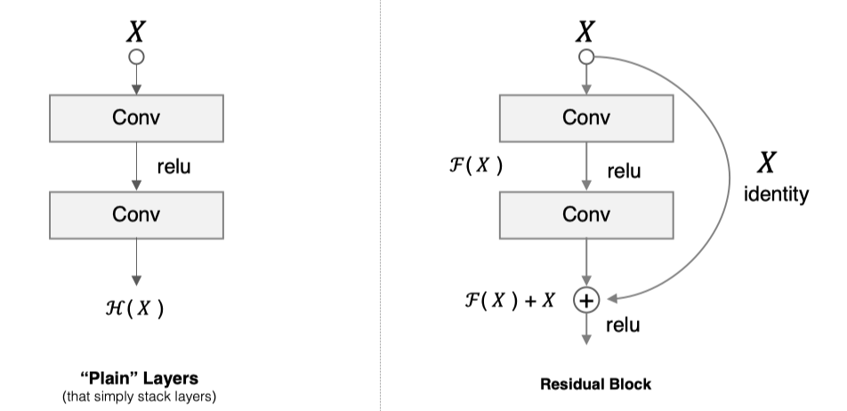
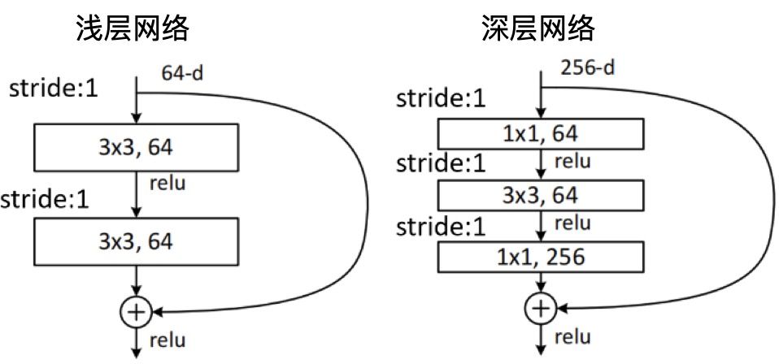
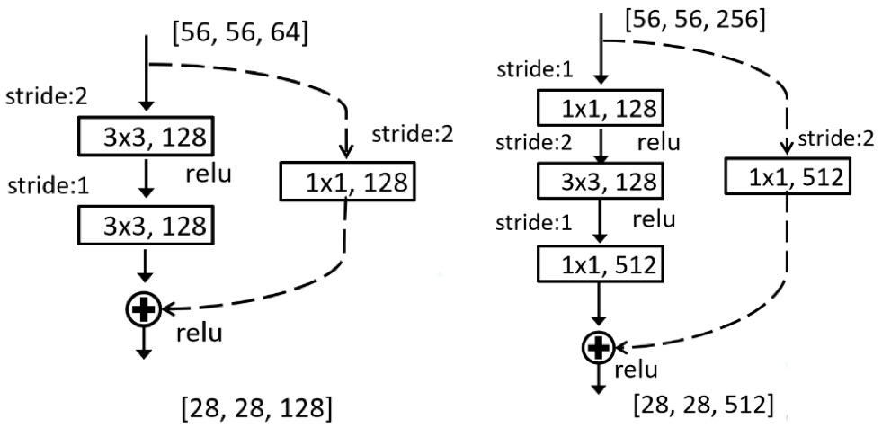
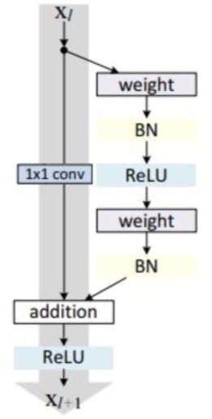
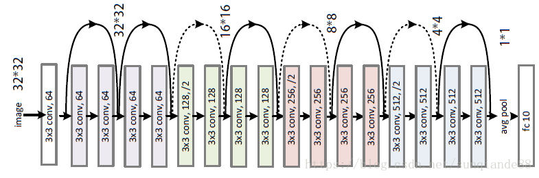
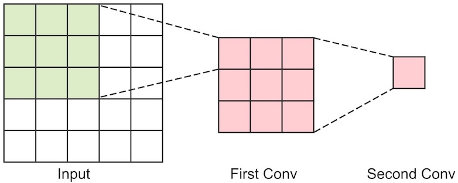

# 残差网络

一般认为，网络越深，特征也越丰富。但是在实践中，随着网络的加深，准确率反而降低了。




退化问题（Addressing Degradation Problem）

* 在深度神经网络中，随着网络深度的增加，理论上模型能力应该增强，可以学习更复杂的特征。
* 实际情况是，当网络深度增加到一定程度后，模型的性能开始下降，这种现象被称为退化问题 。
* 退化问题不是过拟合，即使在训练集上，更深的网络也比浅层网络表现更差。 

这意味着更深的网络训练过程，遇到了困难。

针对这一问题，何恺明等人提出了残差网络残差网络（ResNet）在2015年的ImageNet图像识别挑战赛夺魁，并深刻影响了后来的深度神经网络的设计。


相关论文：[Deep Residual Learning for Image Recognition](https://arxiv.org/pdf/1512.03385)

## 残差层的原理

### 恒等映射（Identity Mapping）

恒等映射，即输入什么就输出什么，不引入任何额外的变换。

> [!important]
>
> 新增的层最差，也应该学习到恒等映射
>
> * 如果新增的层能够学习到恒等映射，那么深层网络至少不会比浅层网络更差。 
> *  如果新增的层还能学习到有效的特征变换，那么深层网络就应该比浅层网络更好。

假设在一个浅层网络上增加了一些层，深层网络性能至少和浅层网络一样，最差的情况是，新增的这些层不影响网络的性能。

### 残差块（Residual Block）



假设卷积层是输入是$X$，训练神经网络的过程就是要找到一个理想的输出$H(X)$

* 理想的输出$H(X)$可以是特征图，以最优的方式满足后面网络的需要。
* 理想的特征图，最差的情况应该与$X$性能一致。

在普通的网络层中，学习目标是希望拟合出理想的输出$H(X)$。而在残差块中，让网络去学习残差函数
$$
F(X) = H(X) - X
$$

* 学习目标是$H(X)$和$X$之间的差异（residual）。
* 假设网络学习到了理想残差函数$F(X)$，最终的输出应该加上原始的输入，即$H(X) = F(X) + X$。

举个例子，假设要把一张略微模糊的猫的图片变得清晰（图像超分辨率任务）。

- 直接学习$H(X)$：让网络直接学习一个映射$H(X)$来输出清晰的猫的图片。
- 学习残差$F(X) = H(X) - X$：让网络学习模糊图像$X$和清晰图像$H(X)$之间的差异。  

这里的加法指的是元素级别的加法，将$F(x)$和原始输入的特征图对应元素相加。

```
A =                B =                    C =
[[1, 2, 3],        [[10, 11, 12],         [[1+10, 2+11, 3+12],
[4, 5, 6],         [13, 14, 15],          [4+13, 5+14, 6+15],
[7, 8, 9]]         [16, 17, 18]]          [7+16, 8+17, 9+18]]
```

> [!important]
>
> 残差模块学习恒等映射，比一般网络更容易，只需要让残差块中的卷积层权重趋近于零即可。

残差模块的优点

* 解决退化问题。通过残差块，有效的解决了恒等映射的学习问题，避免了信息在深层网络中逐渐衰减。
* 减缓梯度消失。残差连接提供了一条直接的梯度通路（gradient highway），梯度可以直接从深层传递到浅层，而无需完全依赖于中间层。
* 学习差异。学习残差意味网络层不是从头开始学习全新的特征，而是学习在输入的基础上进行微调得到理想的输出。

### 残差层的设计

残差块有两种设计分别用于浅层网络和深层网络，



* 在残差网络中，残差块的输入$X$ 和残差分支$F(X)$必须有相同的形状。
* 深层网络中$1\times1$的卷积用于降维。
* 残差块中沿用了VGG的设计，用多层小卷积来代替大的卷积核。

在一些情况下，残差块的输入维度和输出维度可能会发生变化，所以需要在shortcut连接上增加卷积。



实践证明在残差块中加入BN层效果会更好



> [!note]
>
> 构建两个卷积层的残差单元。

## 网络构建

ResNet的层数主要指残差网络中包含的卷积层数量和全连接层数量，经典的残差网层数有：

* ResNet-18
* ResNet-34
* ResNet-50
* ResNet-101
* ResNet-152

ResNet-18结构图如下



* 虚线的残差块表示shortcut上进行了$1\times 1$的卷积。
* 只有最后一个池化层，其它部分图像压缩都是使用卷积层来完成。

> [!note]
>
> 1. 使用残差单元构建残差模块。
> 2. 使用残差模块构建Resnet-18的残差网络。

### 训练模型

> [!note]
>
> 使用Cifar-10的数据训练残差网络。

1. 使用He初始化方法初始化参数。
2. 增加正则化方法。
3. 增加退火策略，使用余弦退火。
4. 增加早停函数，当测试集分数没有提高时停止训练，避免过拟合。
5. 使用图像增强技术：水平翻转、随机裁剪和颜色扰动。

| 优化                                            | 参数                                                         | 准确率 |
| ----------------------------------------------- | ------------------------------------------------------------ | ------ |
| 图像增强、正则化、余弦退火和增加BN层和Dropout层 | EPOCHS=200，BATCH_SIZE=256，<br/>LR=1e-3，WEIGHT_DECAY=2e-3，<br/>DROPOUT= 0.5 | 93.65% |

## 小卷积核的优势

Vgg网络和Resnet网络都使用$3\times 3$的卷积核不断堆叠，来对更大的感受野进行压缩。



$5\times 5$的元素压缩为一个像素输入是$C$个特征图，输出是$C$个特征图

* 使用一个$5\times 5$的卷积核$C\times (5\times 5 \times C)=25C^2$。
* 使用两个$3\times 3$的卷积核$C\times (3\times 3 \times C)+C\times (3\times 3 \times C)=18C^2$。

> [!important]
>
> 1. 卷积过程越多，特征提取越细致，加入的非线性变换更多。
> 2. 堆叠小的卷积核所需的参数更少。
