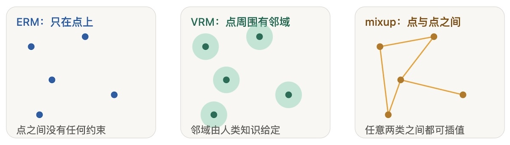
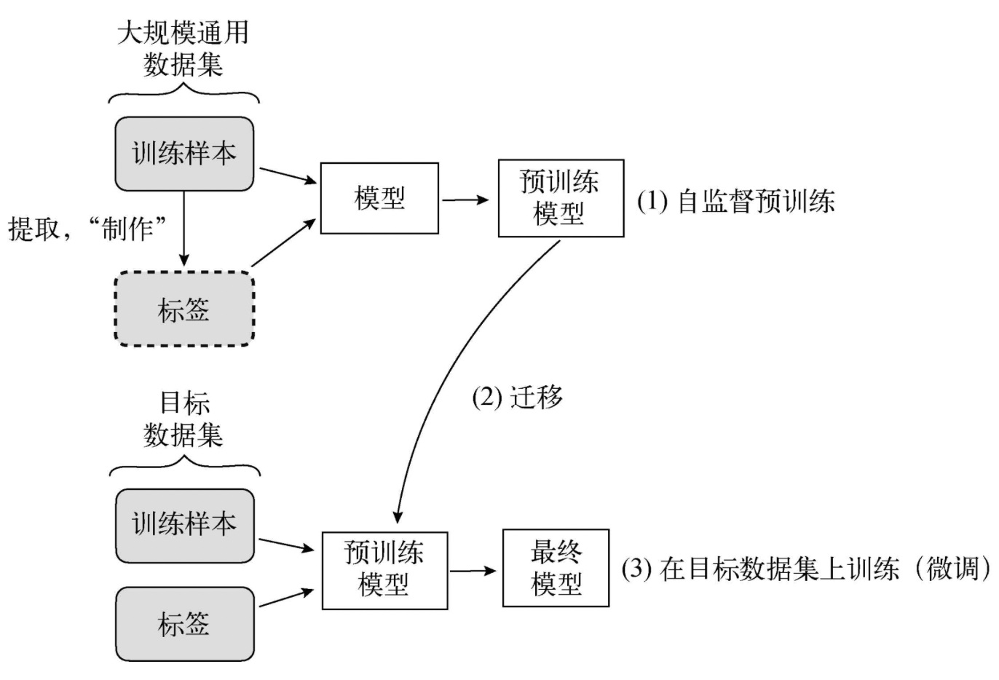

# 更多训练方法

## MixUp方法

MixUp方法是一种数据增强兼正则化方法，核心做法是把两个样本和对应标签按比例搅在一起，造出一个虚拟样本参与训练。

相关论文：[mixup: Beyond Empirical Risk Minimization](https://arxiv.org/pdf/1710.09412)

### 经验风险最小化

经验风险最小化（Empirical Risk Minimization，ERM）准则，就是最小化训练集平均损失的准则
$$
R = \arg\min \frac{1}{n} \sum_{i=1}^{n} Loss(x_i, y_i)
$$

* 针对不同的任务，$Loss$的损失函数形式不同，如：交叉熵损失函数、MSE和MAE等。

### 邻域风险最小化

邻域风险最小化（Vicinal Risk Minimization，VRM），就是把每个训练点换成一个邻域分布，再从邻域里采样构造虚拟样本、最小化风险。数据增强正是VRM的实例。

### MixUp方法

从训练数据中随机抽取的两个样本进行混合
$$
\begin{aligned} 

\tilde{x} &= \lambda x^{(i)} + (1 - \lambda) x^{(j)} \\
\tilde{y} &= \lambda y_i + (1 - \lambda) y_j
\end{aligned}
$$

* 其中$\lambda \in [0, 1]$

> [!important]
>
> MixUp方法假设：特征向量的线性插值，应导致相应目标线性插值。

三种方法的对比图

> [!tip]
>
> 使用MixUp方法在Cifar-10数据集上训练Resnet-18网络。

## 自监督学习

自监督学习是一种预训练过程，能够让神经网络以监督学习的方式学习大规模无标签数据集。自监督学习与迁移学习是相关的。

| 方法    | 主要方法                                             |
| :------ | :--------------------------------------------------- |
| MoCo v2 | 找出数据增强过的同源图，并把它跟缓存队列里的图区分开 |
| SimSiam | 把数据增强过的同源图拉近                             |
| SimCLR  | 找出数据增强过的同源图                               |

### MoCo V2

相关论文：[Improved Baselines with Momentum Contrastive Learning](https://arxiv.org/pdf/2003.04297)

### SimSiam

相关论文：[Exploring Simple Siamese Representation Learning](https://arxiv.org/pdf/2011.10566)

### 模型微调

模型微调（Fine-tuning）是迁移学习（Transfer Learning）中的一种常用技术，指在一个预训练模型（Pre-trained Model）的基础上，通过在新的数据集上进行额外训练，使其适应新任务的过程。

* 模型微调避免了从头训练数据。
* 模型微调一般是在大量数据集上训练模型，以适应小数据集任务。

